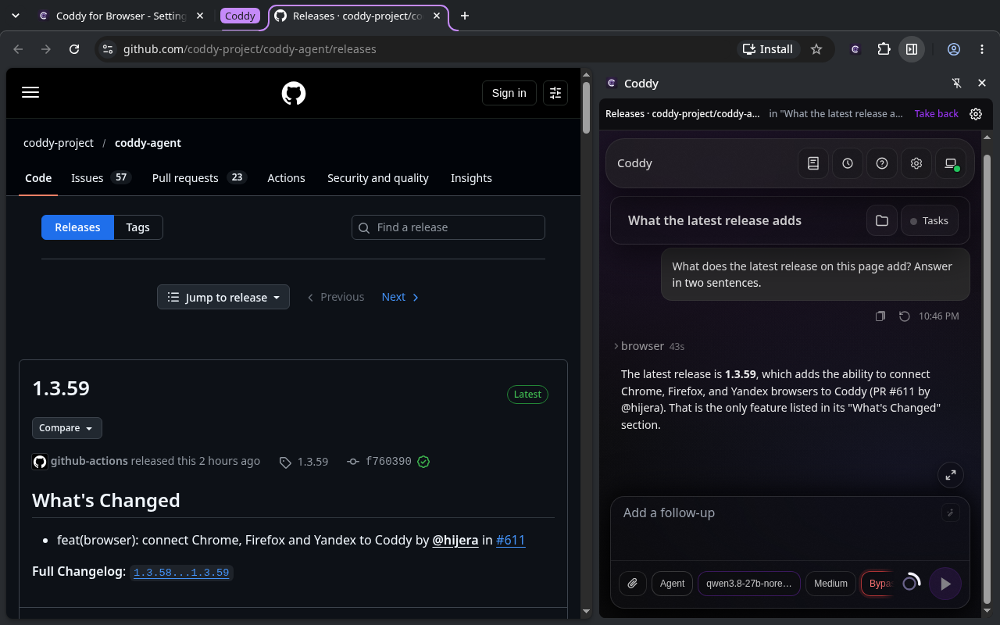
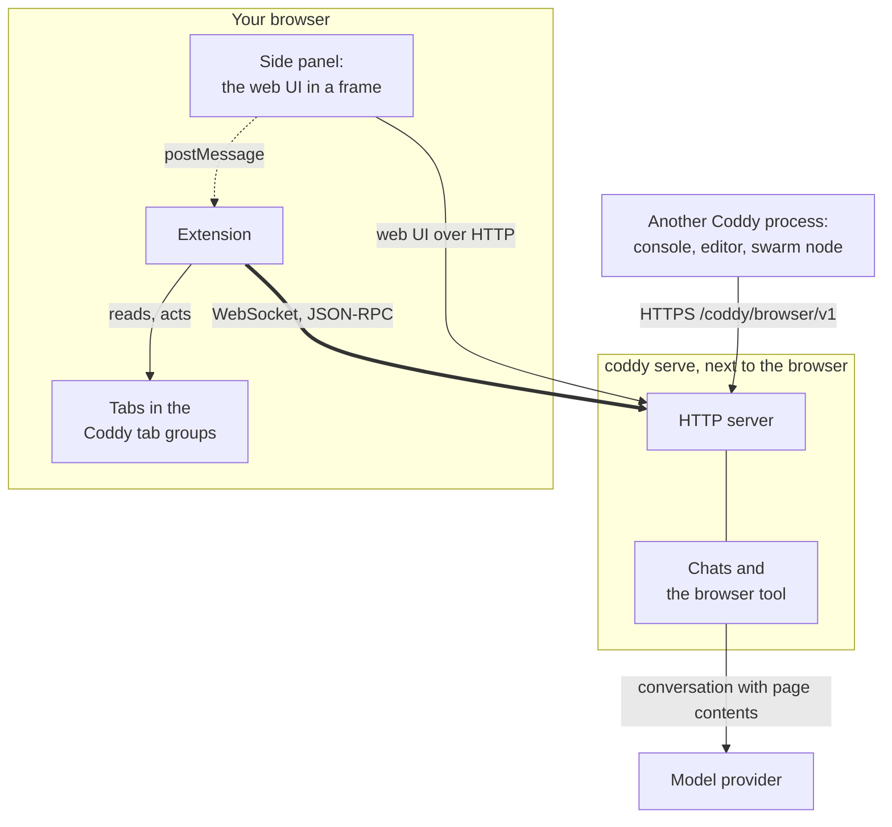
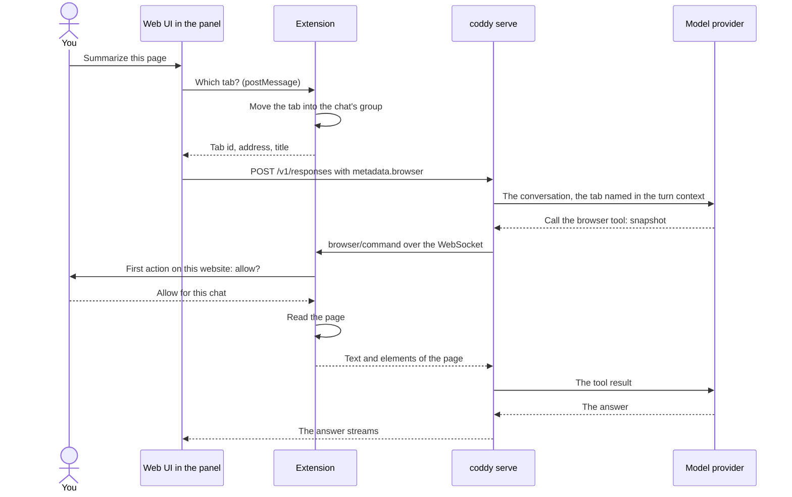
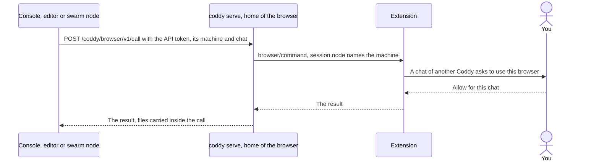

# Coddy for Browser

A browser extension for Chrome, Yandex Browser, Firefox and Firefox for Android that lets your own
[Coddy](https://github.com/coddy-project/coddy-agent) agent work in the browser you use every day. Chat with Coddy in
the side panel next to the page, or let a chat anywhere else in Coddy - the web UI, the console, an editor, Telegram,
a scheduled job, another machine of your swarm - use your browser: it opens a tab, reads the page, clicks, types,
takes screenshots and moves files, and the extension does it in the tabs you share.

[Русская версия](README.ru.md)



The extension talks only to the Coddy server you point it at. The model runs on that server; the extension
executes the actions and asks you before Coddy touches a new website.

## How it works

### The parts



- **The extension dials out.** It opens one WebSocket to the HTTP server of `coddy serve`, its home server, and keeps
  it open. Coddy's actions travel down that socket as requests the extension answers, so Coddy reaches a browser it
  has no route to: a laptop behind NAT works the same as a browser on the server itself.
- **The side panel is the web UI.** The toolbar button opens the web UI of the same server beside the page, signed in
  by a one-time ticket the extension gets over its socket, with the whole composer - models, attachments, approval
  modes, history. The tab you write from goes into the chat's tab group before the message is sent, so "summarize
  this page" or "fill this form" works on the page in front of you.
- **Any chat of your Coddy can use it.** A console or an editor on the same machine, and the other nodes of your
  swarm, reach the browser through the home server's HTTP API (`browser.serve_remote`). The first action of such a
  chat asks you in the extension, naming the machine it runs on.
- **Tab groups decide what Coddy reaches.** Coddy sees only the tabs in its tab groups of the browser. You share a tab
  with every chat by pressing **Share** in the side panel, or by dragging it into the **Coddy** group. A chat that
  works in a shared tab moves it into a group of its own, and no other chat may act there. A tab Coddy opens starts
  in the chat's group. Every one of these groups is titled **Coddy** and coloured purple, and the side panel names
  the chat that holds the tab in front of you. Drag a tab out of a group, or press **Take back**, to take it back.
  Firefox for Android has no tab groups: the extension keeps them itself, so a tab is shared and taken back with
  **Share** and **Take back** in the panel, which names the chat that holds the page you looked at last.
- **You approve websites.** Before the first action on a website, a small window of the extension asks: allow for
  this chat, always allow, or decline. "Always" covers the chats of the home server only: a chat from another
  machine asks for every new website. A page cannot answer these questions for you. Pages on your own machine
  (`localhost`, `127.0.0.1`, `[::1]`, any port) are on the list of sites allowed always from the start, except the
  Coddy server itself, whose web UI approves the chats' own requests; revoke them there like any other site. The
  settings page also takes addresses beforehand - an origin (`https://example.com`), a port (`localhost:3000`), a
  range of ports (`10.0.0.5:8000-8100`) or every port (`example.com:*`) - and a switch that allows every website
  for the chats of your server; your Coddy server still needs an entry with its own port. Chrome and Yandex Browser
  follow your yes with a prompt of their own, once per website: the extension holds only this machine's addresses
  from the install, and every other website from that prompt.
- **You can stop it.** The Stop button on the page Coddy works in cancels every action, ungroups every tab and takes
  back what the chats from other machines were allowed; the tabs stay open. **Disconnect** on the settings page does
  the same and closes the connection.

### A turn from the side panel



### A chat of another Coddy process



### What goes where

| What | From | To | How |
| --- | --- | --- | --- |
| Coddy's actions and their results | `coddy serve` | the extension and back | the WebSocket the extension opened, JSON-RPC 2.0 |
| The extension key | the extension | its home server | in `initialize`, once per connection; kept in the extension's storage |
| The web UI of the panel | the home server | the panel's frame | the web UI's own HTTP, signed in by a one-time ticket from the socket |
| The tab you write from | the panel | the web UI, then the server | `postMessage` inside the browser, then `metadata.browser` of the message |
| Page text, elements and screenshots | the extension | the server, then the model provider | results of the `browser` tool |
| Files | a page or the workspace | the other one | one-time tickets under `/browser/v1/files/`, up to 32 MiB |
| Calls of another Coddy process | that process | the home server | HTTPS `/coddy/browser/v1` with the home server's API token |
| Your answers about websites and chats | - | - | they stay in the browser and never reach Coddy |

The wire protocol is documented in Coddy: [Browser protocol](https://coddy.dev/docs/reference/browser-protocol). The feature
from Coddy's side, with its configuration, is [Coddy for Browser](https://coddy.dev/docs/features/browser).

## Requirements

- A browser:
  - Chrome 116 or newer;
  - Yandex Browser, or another browser built on Chromium, from the same package as Chrome. Yandex Browser has no
    side panel, so the web UI opens in a window of its own beside the browser's;
  - Firefox 140 or newer, from the Firefox package. Firefox has no debugger API for extensions, so Coddy clicks and
    types through the page: a page can tell such input from a person's, and a site that checks for it (some editors,
    some sign-in forms) does not react;
  - Firefox for Android 142 or newer, from the Firefox package. It gives extensions no tab groups, sidebar or
    windows, so the extension keeps the tab groups itself, and the web UI and the questions about websites open in
    tabs; input goes through the page, as in Firefox.
- `coddy serve` built with the `browser` and `ui` tags, with its HTTP server on. The release binaries, the Docker image
  and the packages carry them.
- Coddy for Browser turned on in Coddy's `config.yaml`, with a key of at least 32 characters:

  ```yaml
  browser:
    enable: true
    token: ${CODDY_BROWSER_KEY}
    serve_remote: true   # optional: chats of a console, an editor or another node use this browser too
  ```

  Generate the key with `openssl rand -hex 32` and keep it in `<home>/.env` as `CODDY_BROWSER_KEY`. The extension
  connects to the HTTP server, the address the web UI has. Run `coddy serve` on the machine of the browser; for a
  server on another machine, put the HTTP server on HTTPS: the extension uses plain HTTP only for `localhost`,
  `127.0.0.1` and `[::1]`. A machine reachable only through your swarm joins it with `swarm.join`, and the other nodes
  reach its browser through the relay.

## Install

Every [release](https://github.com/coddy-project/coddy-for-browser/releases) carries the packages and goes to the
Chrome Web Store and addons.mozilla.org as well, which publish it once their review passes; its notes link the
listings. Every run of the [CI workflow](https://github.com/coddy-project/coddy-for-browser/actions/workflows/ci.yaml)
keeps a build of each family among its artifacts, `coddy-for-browser-chrome` and `coddy-for-browser-firefox`: the
archive GitHub hands out is the same package as the release's (downloading an artifact needs a GitHub account).

| Package | Browsers |
| --- | --- |
| `coddy-for-browser-chrome-<version>.zip` | Chrome, Yandex Browser and other Chromium browsers |
| `coddy-for-browser-firefox-<version>.zip` | Firefox and Firefox for Android, unsigned |

### Chrome

1. Unpack `coddy-for-browser-chrome-<version>.zip` into a folder you keep.
2. Open `chrome://extensions`, turn on **Developer mode** and press **Load unpacked**. Choose the unpacked folder.

### Yandex Browser

1. Unpack `coddy-for-browser-chrome-<version>.zip` into a folder you keep.
2. Open `browser://extensions`, turn on **Developer mode** and press **Load unpacked**. Choose the unpacked folder.

The toolbar button opens the web UI in a window of its own, placed at the right edge of the browser's window.

### Firefox

- **From addons.mozilla.org**, once the version is published there: like any add-on.
- **Unsigned** (`.zip`): release Firefox installs only add-ons Mozilla signed. Open
  `about:debugging#/runtime/this-firefox`, press **Load Temporary Add-on** and choose the archive; Firefox removes a
  temporary add-on when it closes. Firefox Developer Edition and Nightly keep the unsigned archive installed from
  `about:addons` (**Install Add-on From File**) once `xpinstall.signatures.required` is `false` in `about:config`.

The toolbar button opens the web UI in Firefox's sidebar.

### Firefox for Android

- **From addons.mozilla.org**, once the version is published there: **Add-ons** in the browser's menu.
- **Unsigned**, for development: release Firefox for Android installs add-ons from addons.mozilla.org only, and
  `web-ext` installs the build on a phone or an emulator over `adb`, with USB debugging on the phone and remote
  debugging in Firefox's settings:

  ```bash
  npx web-ext run --target firefox-android --source-dir dist/firefox --android-device <adb id>
  ```

The extension's entry under **Extensions** in the browser's menu opens the web UI in a tab of its own; **Share** and
**Take back** there act on the page you looked at last. A question about a website brings the open web UI forward, or
opens in a tab of its own that closes once it is answered.

### From source

Node.js 22 or newer, no packages to install:

```bash
npm run build
```

`dist/chrome` is the Chrome and Yandex Browser build, `dist/firefox` the Firefox and Firefox for Android one; load them
as above.

## Connect

The settings page opens after the install, and later from the settings button of the side panel (or from the
extension's entry in the browser's list of extensions). Enter the server address (`http://127.0.0.1:12345` for a
local server, the address of its web UI), the key and a name for this browser, such as `Chrome - laptop`, then press
**Save and connect**. The name tells browsers apart when several are connected to one server: a chat lists them and
selects one.


The settings page shows the connection in its corner: green while connected, amber while it connects or retries,
grey while disconnected, red when the server refused the key or speaks another protocol version. **Disconnect** stops Coddy and closes the
connection.

## Use it

Press the toolbar button and write in the side panel, on the page you want Coddy to work with:

> Summarize this page and list the deadlines it mentions.

The panel is the web UI: the answer streams, the tool calls show as they run, Coddy's questions come up in the chat,
and the chat is an ordinary session you can continue anywhere. The strip over it shows the tab you look at and whose
it is, with **Share** and **Take back**, and the settings button, in the web UI's theme.

Open the panel on a tab a chat of your server works in, and the panel shows that chat: a turn started from the
console, an editor or a scheduled job streams there as in any chat. The chat's name in the strip opens it again.

From any other chat of Coddy, share a tab or let Coddy open one, and ask:

> Open the pull request list of coddy-project/coddy-agent and tell me which ones wait for review.

The chat calls the `browser` tool: it lists the tabs it may reach, reads a page as text with element references,
clicks and types (through the debugger in Chrome and Yandex Browser, so the input is trusted like a person's; through
the page in Firefox), and attaches screenshots when its model reads images. While Coddy works in a tab, the tab glows
and shows a Stop button, and the chat's group title starts with an hourglass.


Before the first action on a website, the extension asks in a window of its own, or in the side panel when it is
open:

<p align="center">
  
</p>

In Chrome and Yandex Browser, the first yes to a website brings up the browser's own prompt for that website too, and
so do a website added on the settings page, the switch for every website and the address of a Coddy server on another
machine. Firefox lets the extension into every website from the install, and the extension's own question decides.

A chat of another Coddy process asks first, naming the machine it runs on:

<p align="center">
  
</p>

## Permissions

| Permission | Why |
| --- | --- |
| `tabs`, `tabGroups` | Read the tabs in the Coddy groups, open and group tabs for a chat. Firefox has tab groups from version 139; Firefox for Android has none, and the extension keeps the groups itself. |
| `scripting` | Read a page and resolve element references; show the working indicator. |
| `debugger` | Chrome and Yandex Browser: trusted clicks, typing and keys, and screenshots through the DevTools protocol. The browser shows a bar while it is attached; the extension detaches 20 s after the last action. Firefox has no such API. |
| `storage` | The connection settings and the websites you allowed. The key is readable only by the extension's own pages. |
| `alarms` | Wake the service worker to reconnect after Chrome stopped it; Firefox keeps its background page running. |
| `notifications` | Tell you that Coddy asks to use a website. |
| `sidePanel` | Chrome: the web UI beside the page. Firefox takes a sidebar from the manifest instead, Yandex Browser opens a window, and Firefox for Android a tab. |
| `localhost`, `127.0.0.1`, `[::1]` | Reach a Coddy server on this machine and act on the pages of this machine, which are on the list of sites allowed always from the start. |
| `http://*/*`, `https://*/*`, optional | Chrome and Yandex Browser: act on a website once you allow it, and reach a Coddy server on another machine once you save its address. The browser grants each one in a prompt of its own, once; nothing beyond this machine is granted at install. Firefox holds `<all_urls>` from the install instead, which its screenshot of a tab (`tabs.captureTab`) needs; the extension still acts on web pages only, after its own question. |

The extension sends nothing anywhere but your Coddy server. Pages Coddy reads still reach the model provider your
Coddy server is configured with. The [privacy policy](PRIVACY.md) lists what goes to the server and what stays in the
browser.

## Develop

```bash
npm test                      # unit tests, Node only
npm run build                 # dist/chrome, dist/firefox and their archives
npm ci                        # once: Playwright, Puppeteer and web-ext at the versions package-lock.json pins
npx playwright install chromium
npm run e2e                   # the Chrome build in a real Chromium against a mock of Coddy
npm run e2e:firefox           # the Firefox build in a real Firefox against the same mock
npm run security              # the security checks of CI (needs Docker or the scanners, and npm ci)
```

The icons are rendered from `src/icons/icon-small.svg` (16 and 32 px, the tile fills the icon) and
`src/icons/icon.svg` (48 and 128 px, with the margin the stores ask for) by `npm run icons`, which needs Playwright.

`CODDY_BROWSER_PATH` points the Chromium run at an installed browser instead of Playwright's Chromium - Google Chrome,
Yandex Browser - which gets the extension through the DevTools protocol, since branded browsers ignore
`--load-extension`. `CODDY_FIREFOX_PATH` names the Firefox of the Firefox run. `CODDY_SCREENSHOT_DIR` collects
screenshots of the extension's pages.

The [CI workflow](.github/workflows/ci.yaml) runs the unit tests, builds both packages as artifacts and runs both
end-to-end runs on every push and pull request.

### Security checks

A pull request is checked before it lands, and `main` once a week as well:

- [security.yaml](.github/workflows/security.yaml) runs `scripts/security-scan.sh`, which is what `npm run security`
  runs on a developer's machine: trivy (vulnerable packages of `package-lock.json`, the development tools included,
  committed secrets, misconfiguration), semgrep (rules for JavaScript, secrets and GitHub Actions over the extension, the
  scripts and the tests), zizmor (the workflows: expressions a pull request controls, unpinned actions, dangerous
  triggers) and `web-ext lint`, the validator addons.mozilla.org runs on every submission, over a fresh Firefox build;
- [codeql.yaml](.github/workflows/codeql.yaml) runs the security queries of CodeQL over the JavaScript and the
  workflows.

The check fails on a trivy finding of HIGH or above, a semgrep finding of WARNING or above, any zizmor finding and a
validator error. `SEC_FAIL_TRIVY`, `SEC_FAIL_SEMGREP`, `SEC_FAIL_ZIZMOR` and `SEC_FAIL_AMO` move those thresholds (the
header of the script lists every knob). The reports land in `dist/security/`, and the findings of trusted runs go to
code scanning. Each scanner runs from its binary on `PATH` or from an image pinned by digest, so a local run needs
Docker or the binaries, and `npm ci` for web-ext. An accepted trivy finding goes into `.trivyignore.yaml` with a
statement and an expiry; a semgrep finding is suppressed where it is, with a `nosemgrep` comment that says why.

A pull request from a fork runs with a read-only token and none of the repository's secrets. Only the release jobs use
the store credentials, and they run on `main`. Every action is pinned to a commit, no checkout keeps credentials in
`.git`, and the tools come from `package-lock.json` without install scripts.

### Releases

Merging a pull request into `main` releases it once the repository variable `RELEASE_ON_MERGE` is `true`; until then a
merge releases nothing. [tag-on-merge.yaml](.github/workflows/tag-on-merge.yaml) tags the merge commit with the next
version: the patch after the newest `X.Y.Z` tag, or the version of `package.json` when that is higher, so a pull request
raises the minor or major version by editing `package.json`. Then [release.yaml](.github/workflows/release.yaml) builds
that version into both manifests, attaches the packages to a GitHub release and submits them to the Chrome Web Store and
addons.mozilla.org where publishing there is switched on; the stores publish the version once their review passes. A
direct push to `main` releases nothing. **Run workflow** on *Tag release on merge* tags the head of `main` and releases
it whatever the variable says, or, with a tag given, releases that tag again.

One job builds the packages, and the GitHub release and each store are jobs of their own that take those packages. A
job that failed is run again alone (**Re-run failed jobs**, or that job's own re-run), and a store job skips a version
the store already holds, so a release half done is finished without touching what went through.

Publishing to a store is switched on by the repository variable `CWS_PUBLISH` or `AMO_PUBLISH` set to `true`
(Settings, Secrets and variables, Actions, or `gh variable set AMO_PUBLISH --body true`). While it is not, the job of
that store is skipped, the release goes out without it, and the release notes do not name it. Each store also needs a
one-time setup; until it is done, its job prints what is missing and the release goes out without that store.

- **Chrome Web Store** (`scripts/publish-chrome.mjs`, API v2). Register as a developer, create the item by uploading the
  first package by hand in the developer dashboard, and fill in its store listing and privacy tabs. Then enable the
  Chrome Web Store API in a Google Cloud project, create an OAuth client and get a refresh token for the
  `https://www.googleapis.com/auth/chromewebstore` scope, as
  [Use the Chrome Web Store API](https://developer.chrome.com/docs/webstore/using-api) shows. The repository needs the
  secrets `CWS_CLIENT_ID`, `CWS_CLIENT_SECRET` and `CWS_REFRESH_TOKEN`, and the variables `CWS_PUBLISHER_ID` (Publisher,
  Settings in the dashboard) and `CWS_EXTENSION_ID` (the item's id). Yandex Browser installs extensions from the
  Chrome Web Store too.
- **addons.mozilla.org** (`scripts/sign.mjs listed`). An API key from the developer hub (Tools, Manage API Keys) goes
  into the secrets `AMO_JWT_ISSUER` and `AMO_JWT_SECRET`. The first submission creates the listing with the metadata of
  `amo/metadata.json`, and Mozilla reviews every version before it is public. `node scripts/sign.mjs unlisted` signs a
  build for self-distribution instead; AMO numbers versions across both channels, so one version goes to one of them.

| File | What it does |
| --- | --- |
| `src/background.js` | The background (a service worker in Chrome, a page in Firefox): wiring, the messages of the side panel, the approval window and the settings page. |
| `src/platform.js` | What the browser offers: the side panel, the sidebar, the debugger, windows and tab groups. |
| `src/panel.js`, `src/frame.js` | The side panel: the web UI in a frame, signed in by its ticket, and the bridge that gives a turn its tab and takes the web UI's theme. |
| `src/connection.js` | The WebSocket, `initialize`, keepalive and reconnects. |
| `src/rpc.js` | The JSON-RPC 2.0 peer. |
| `src/commands.js` | Every action Coddy asks for, with the checks before it. |
| `src/groups.js` | The Coddy tab groups and who holds which tab. |
| `src/virtualgroups.js` | Tab groups the extension keeps itself where the browser has none (Firefox for Android). |
| `src/approvals.js`, `src/policy.js` | Website approvals and address checks. |
| `src/access.js` | The browser's own grant of websites: asked for in the click that allows one, checked before an action. |
| `src/page.js`, `src/input.js`, `src/pageinput.js`, `src/indicator.js` | What runs in a page, input through the DevTools protocol (Chrome) or through the page (Firefox), the working indicator. |
| `scripts/build.mjs` | The build of each browser family (the Firefox manifest is Manifest V2). |
| `scripts/next-version.mjs`, `scripts/publish-chrome.mjs`, `scripts/sign.mjs` | The version of the next release, the upload to the Chrome Web Store and the submission to addons.mozilla.org. |
| `scripts/security-scan.sh` | The security checks of CI and of `npm run security`. |

A change to the protocol goes to both repositories: the extension and `external/browser` in coddy-agent, with the
protocol page updated in the same change.

## License

MIT, see [LICENSE](LICENSE).
