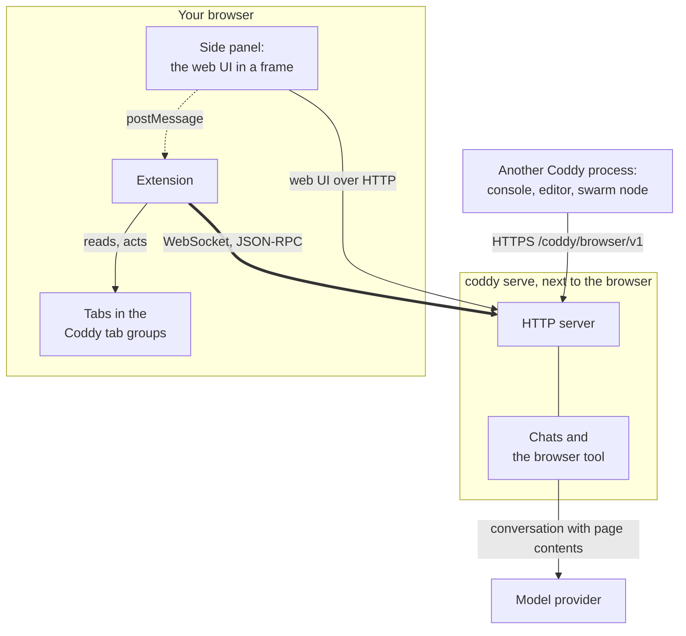
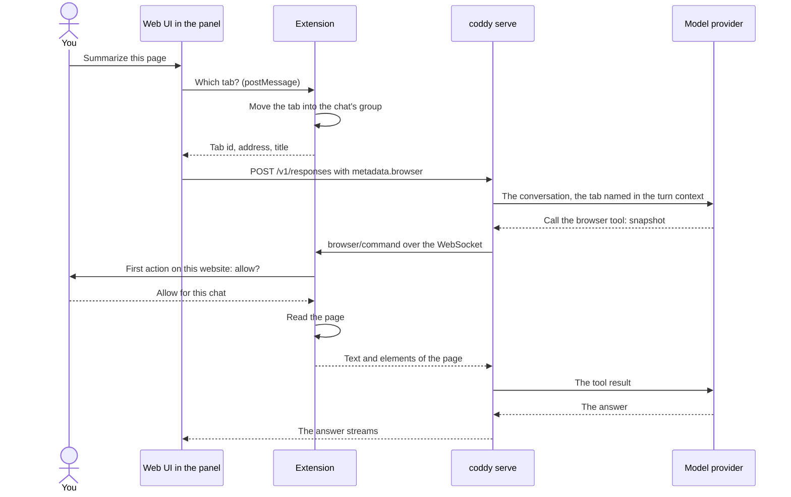
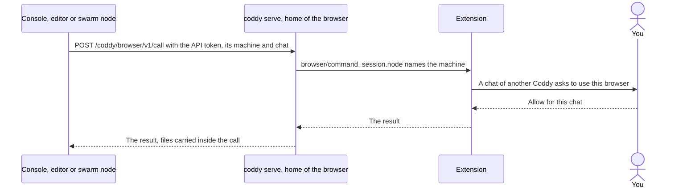

<p align="center">
  
</p>

<h1 align="center">Coddy for Browser</h1>

<p align="center">
  <b>Your own <a href="https://github.com/coddy-project/coddy-agent">Coddy</a> agent, working in the browser you use every day.</b>
  <br>
  Chrome · Yandex Browser · Firefox · Firefox for Android
</p>

<p align="center">
  <a href="https://github.com/coddy-project/coddy-for-browser/releases/latest"></a>
  <a href="https://github.com/coddy-project/coddy-for-browser/actions/workflows/ci.yaml"></a>
  <a href="LICENSE"></a>
</p>

<p align="center">
  <b>Install for <a href="https://chromewebstore.google.com/detail/coddy-for-browser/pdppgelbaehcedjpgfonemkmglpjifni">Chrome and Yandex Browser</a> · <a href="https://addons.mozilla.org/firefox/addon/coddy-for-browser/">Firefox and Firefox for Android</a></b>
</p>

<p align="center">
  <b>English</b> · <a href="README.ru.md">Русский</a>
</p>

<picture>
  <source media="(prefers-color-scheme: dark)" srcset="docs/screenshots/chrome-panel-dark-1280.png">
  
</picture>

A browser extension that lets your own Coddy agent work in the browser you use every day. Chat with Coddy in the side
panel next to the page, or let a chat anywhere else in Coddy - the web UI, the console, an editor, Telegram, a scheduled
job, another machine of your swarm - use your browser: it opens a tab, reads the page, clicks, types, takes screenshots
and moves files, and the extension does it in the tabs you share.

The extension talks only to the Coddy server you point it at. The model runs on that server; the extension executes
the actions and asks you before Coddy touches a new website.

## Features

- **The web UI beside the page.** The toolbar button opens the web UI of your server in Chrome's side panel, Firefox's
  sidebar or a window of its own in Yandex Browser; on a phone, the extension's entry in the browser's menu opens it in
  a tab. The whole composer comes along: models, attachments, approval modes, history.
- **The page in front of you.** The tab you write from goes with the message, so "summarize this page" or "fill this
  form" works on that page.
- **Any chat of your Coddy.** A Telegram chat or a scheduled job of the same server works in the browser as the side
  panel does. The console, an editor or another node of your swarm asks you first, naming the machine it runs on.
- **Only the tabs you share.** Coddy reaches the tabs in its tab groups: the ones you share and the ones a chat opens.
- **A question before each new website.** Allow it for the chat, allow it always, or decline. A page cannot answer for
  you.
- **Clicks, typing and files.** Keys, hovering, scrolling, dragging, screenshots and files both ways as well. In
  Chrome and Yandex Browser the input goes through the debugger, so pages trust it like a person's.
- **A Stop button on the page.** It cancels every action and ungroups every tab; the tabs stay open.

## Browsers

| Browser | Version | The web UI opens in | Clicks and typing go |
| --- | --- | --- | --- |
| Chrome | 116 or newer | the side panel | through the debugger |
| Yandex Browser and other Chromium browsers | Chromium 116 or newer | the side panel, or a window of its own beside the browser's where there is none (Yandex Browser) | through the debugger |
| Firefox | 140 or newer | the sidebar | through the page |
| Firefox for Android | 142 or newer | a tab | through the page |

Firefox has no debugger API for extensions, so Coddy clicks and types through the page there: a page can tell such
input from a person's, and a site that checks for it (some editors, some sign-in forms) does not react. Firefox for
Android gives extensions no tab groups, sidebar or windows either, so the extension keeps the tab groups itself, and
the web UI and the questions about websites open in tabs.

## Quick start

1. **Turn the browser on in Coddy.** You need `coddy serve` built with the `browser` and `ui` tags, with its HTTP
   server on; the release binaries, the Docker image and the packages carry them. Add to Coddy's `config.yaml`:

   ```yaml
   browser:
     enable: true
     token: ${CODDY_BROWSER_KEY}
     serve_remote: true   # optional: chats of a console, an editor or another node use this browser too
   ```

   Generate the key, at least 32 characters, with `openssl rand -hex 32` and keep it in `<home>/.env` as
   `CODDY_BROWSER_KEY`. Run `coddy serve` on the machine of the browser. A server on another machine needs HTTPS: the
   extension uses plain HTTP only for `localhost`, `127.0.0.1` and `[::1]`.
2. **[Install](#install) the extension** from the store for your browser.
3. **[Connect](#connect).** On the settings page that opens after the install, enter the address of the server's web
   UI (`http://127.0.0.1:12345` for a local server), the key and a name for this browser, and press **Save and
   connect**.
4. **Ask.** Press the toolbar button on a page and write in the side panel: "Summarize this page and list the deadlines
   it mentions."

The feature from Coddy's side, with all its settings, is [Coddy for Browser](https://coddy.dev/docs/features/browser).
A machine reachable only through your swarm joins it with `swarm.join`, and the other nodes reach its browser through
the relay.

## Install

| Browser | Install from |
| --- | --- |
| Chrome, Yandex Browser and compatible Chromium browsers | [Chrome Web Store](https://chromewebstore.google.com/detail/coddy-for-browser/pdppgelbaehcedjpgfonemkmglpjifni) |
| Firefox and Firefox for Android | [Firefox Add-ons](https://addons.mozilla.org/firefox/addon/coddy-for-browser/) |

Firefox on desktop and Android uses the same listing and package. Installation from AMO becomes available once
Mozilla publishes a compatible version; Firefox for Android needs version 142 or newer. Open the Firefox Add-ons
link in Firefox on the device where you want to install it.

### Updates

With automatic updates enabled, your browser updates an extension installed from its store when a newer version
is published there. A GitHub release can appear before the stores finish reviewing it. The browser uses the store's
version, not the ZIP attached to the GitHub release. See the update guides for
[Chrome](https://developer.chrome.com/docs/extensions/develop/concepts/extensions-update-lifecycle) and
[Firefox](https://extensionworkshop.com/documentation/manage/updating-your-extension/).

Chrome can defer installing a downloaded update while the side panel or the connection to Coddy is open. Restart
Chrome if an update is waiting. Unpacked Chromium builds and temporary Firefox add-ons do not receive store updates;
replace the unpacked files and reload the extension, or load the new Firefox archive manually.

### Packages for manual installation

Every [release](https://github.com/coddy-project/coddy-for-browser/releases) carries the packages and goes to the
Chrome Web Store and addons.mozilla.org as well, which publish it once their review passes; its notes link the
listings. Every run of the [CI workflow](https://github.com/coddy-project/coddy-for-browser/actions/workflows/ci.yaml)
keeps a build of each family among its artifacts, `coddy-for-browser-chrome` and `coddy-for-browser-firefox`: the
archive GitHub hands out is the same package as the release's (downloading an artifact needs a GitHub account).

| Package | Browsers |
| --- | --- |
| `coddy-for-browser-chrome-<version>.zip` | Chrome, Yandex Browser and other Chromium browsers |
| `coddy-for-browser-firefox-<version>.zip` | Firefox and Firefox for Android, unsigned |

### Chrome

Install from the [Chrome Web Store](https://chromewebstore.google.com/detail/coddy-for-browser/pdppgelbaehcedjpgfonemkmglpjifni).
For development or a manual installation:

1. Unpack `coddy-for-browser-chrome-<version>.zip` into a folder you keep.
2. Open `chrome://extensions`, turn on **Developer mode** and press **Load unpacked**. Choose the unpacked folder.

### Yandex Browser

Install from the same [Chrome Web Store listing](https://chromewebstore.google.com/detail/coddy-for-browser/pdppgelbaehcedjpgfonemkmglpjifni).
For development or a manual installation:

1. Unpack `coddy-for-browser-chrome-<version>.zip` into a folder you keep.
2. Open `browser://extensions`, turn on **Developer mode** and press **Load unpacked**. Choose the unpacked folder.

The toolbar button opens the web UI in a window of its own, placed at the right edge of the browser's window.

### Firefox

- **From [Firefox Add-ons](https://addons.mozilla.org/firefox/addon/coddy-for-browser/)**, once the version is
  published there: like any add-on, with updates through Firefox.
- **Unsigned** (`.zip`): release Firefox installs only add-ons Mozilla signed. Open
  `about:debugging#/runtime/this-firefox`, press **Load Temporary Add-on** and choose the archive; Firefox removes a
  temporary add-on when it closes. Firefox Developer Edition and Nightly keep the unsigned archive installed from
  `about:addons` (**Install Add-on From File**) once `xpinstall.signatures.required` is `false` in `about:config`.

The toolbar button opens the web UI in Firefox's sidebar.


### Firefox for Android

- **From [Firefox Add-ons](https://addons.mozilla.org/firefox/addon/coddy-for-browser/)**, once a compatible version
  is published there: open this same listing in Firefox for Android and install it, or use **Extensions** in the
  browser's menu.
- **Unsigned**, for development: release Firefox for Android installs add-ons from addons.mozilla.org only, and
  `web-ext` installs the build on a phone or an emulator over `adb`, with USB debugging on the phone and remote
  debugging in Firefox's settings:

  ```bash
  npx web-ext run --target firefox-android --source-dir dist/firefox --android-device <adb id>
  ```

The extension's entry under **Extensions** in the browser's menu opens the web UI in a tab of its own; **Share** and
**Take back** there act on the page you looked at last. A question about a website brings the open web UI forward, or
opens in a tab of its own that closes once it is answered.

### From source

Node.js 22 or newer, no packages to install:

```bash
npm run build
```

`dist/chrome` is the Chrome and Yandex Browser build, `dist/firefox` the Firefox and Firefox for Android one; load them
as above.

## Connect

The settings page opens after the install, and later from the settings button of the side panel (or from the
extension's entry in the browser's list of extensions). Enter the server address (`http://127.0.0.1:12345` for a
local server, the address of its web UI), the key and a name for this browser, such as `Chrome - laptop`, then press
**Save and connect**. The name tells browsers apart when several are connected to one server: a chat lists them and
selects one.

<picture>
  <source media="(prefers-color-scheme: dark)" srcset="docs/screenshots/settings-dark-1280.png">
  
</picture>

The settings page shows the connection in its corner: green while connected, amber while it connects or retries,
grey while disconnected, red when the server refused the key or speaks another protocol version. **Disconnect** stops
Coddy and closes the connection.

### A phone with Firefox for Android

<table>
  <tr>
    <td width="33%"></td>
    <td width="33%"></td>
    <td width="33%"></td>
  </tr>
</table>

The extension on a phone connects to a Coddy server the same way, in one of three setups. In each, the settings page
opens from **Extensions** in the browser's menu (**Coddy for Browser**, then the settings button of the panel), and
the web UI opens in a tab of its own from the same entry. Coddy keeps working with Firefox in the background, behind
Termux or another app; a question about a website or a chat then waits in Firefox, so let Firefox show notifications
when Android asks, and the notification tells you. A page Coddy points into or takes a picture of comes to the front
first: Firefox for Android lays out and captures only the tab in front.

<details>
<summary><b>Coddy on the phone itself</b>, in Termux</summary>

`coddy serve` runs in [Termux](https://termux.dev), and the extension connects to it over the phone's loopback, so
nothing leaves the phone but the model calls. Install Termux (F-Droid, its GitHub releases or Google Play), then in
Termux:

```bash
pkg install curl tmux
curl -fsSL https://coddy.dev/install.sh | bash
source ~/.bashrc
```

Turn the browser on in `~/.coddy/config.yaml`, next to the provider and model of
[Configuration](https://coddy.dev/docs/getting-started/configuration):

```yaml
browser:
  enable: true
  token: ${CODDY_BROWSER_KEY}
```

Put `CODDY_BROWSER_KEY=<openssl rand -hex 32>` into `~/.coddy/.env`, start the server with `termux-wake-lock` and
`tmux new -s coddy 'coddy serve'`, and enter `http://127.0.0.1:12345` and the key on the extension's settings page.
Let Termux run unrestricted in Android's battery settings, or Android stops the server when the screen goes off
([Android (Termux)](https://coddy.dev/docs/getting-started/android)).

</details>

<details>
<summary><b>Coddy on another machine</b>, behind HTTPS</summary>

A `coddy serve` on a laptop or a server drives the phone's browser over the network. The extension takes plain HTTP
only for the phone's own loopback, so the server needs HTTPS: `coddy serve` has no TLS of its own, and a
TLS-terminating proxy (Caddy, nginx) in front of its HTTP server gives it one. Enter the proxy's address, such as
`https://coddy.example.com`, and the server's `browser.token` on the settings page.

A certificate of a public authority works as it is. One of your own certificate authority needs two steps on the
phone: install the authority's certificate in Android as a CA certificate (under **Encryption and credentials** in the
security settings, named a little differently between Android versions), then turn on **Use third party CA
certificates** in Firefox's **Secret Settings**, which appear after five taps on the Firefox logo under **Settings**,
**About Firefox**. With `browser.serve_remote: true` the chats of the server's console, editors and swarm nodes reach
the phone's browser too, and each asks on the phone first.

</details>

<details>
<summary><b>The phone as a node of a swarm</b></summary>

Coddy in Termux joins a relay on a laptop or a server with `swarm.join`, as in
[Android phones as swarm nodes](https://coddy.dev/docs/tutorials/swarm-android-nodes), and the extension connects to
the phone's own `coddy serve` over loopback, as in the first setup. The phone dials the relay, so it needs no public
address and no open port, and the relay's web UI and console drive it through that connection: a turn started there
on the phone runs on the phone and uses its browser like any chat of the phone's server. Other machines of the swarm
reach the phone's browser through the relay at `<relay>/swarm/nodes/<phone>/coddy/browser/v1/...` once the phone has
`browser.serve_remote: true`, and each of their chats asks on the phone first. The phone's `~/.coddy/config.yaml`:

```yaml
httpserver:
  enable: true
  auth_token: ${NODE_TOKEN}
browser:
  enable: true
  token: ${CODDY_BROWSER_KEY}
  serve_remote: true
swarm:
  join:
    - url: https://relay.example.com:12346
      name: pixel
      pairing_token: ${SWARM_PAIRING_TOKEN}
      token: ${NODE_TOKEN}
```

</details>

## Use it

Press the toolbar button and write in the side panel, on the page you want Coddy to work with:

> Summarize this page and list the deadlines it mentions.

The panel is the web UI: the answer streams, the tool calls show as they run, Coddy's questions come up in the chat,
and the chat is an ordinary session you can continue anywhere. The strip over it shows the tab you look at and whose
it is, with **Share** and **Take back**, and the settings button, in the web UI's theme.

Open the panel on a tab a chat of your server works in, and the panel shows that chat: a turn started from the
console, an editor or a scheduled job streams there as in any chat. The chat's name in the strip opens it again.

From any other chat of Coddy, share a tab or let Coddy open one, and ask:

> Open the pull request list of coddy-project/coddy-agent and tell me which ones wait for review.

The chat calls the `browser` tool: it lists the tabs it may reach, reads a page as text with element references,
clicks and types (through the debugger in Chrome and Yandex Browser, so the input is trusted like a person's; through
the page in Firefox), and attaches screenshots when its model reads images. While Coddy works in a tab, the tab glows
and shows a Stop button, and the chat's group title starts with an hourglass.

<picture>
  <source media="(prefers-color-scheme: dark)" srcset="docs/screenshots/working-tab-dark-1280.png">
  
</picture>

### Questions before Coddy acts

Before the first action on a website, the extension asks in a window of its own, or in the side panel when it is
open. In Chrome and Yandex Browser, the first yes to a website brings up the browser's own prompt for that website
too, and so do a website added on the settings page, the switch for every website and the address of a Coddy server
on another machine. Firefox lets the extension into every website from the install, and the extension's own question
decides.

<table>
  <tr>
    <td width="53%">
      <picture>
        <source media="(prefers-color-scheme: dark)" srcset="docs/screenshots/site-approval-dark-510.png">
        
      </picture>
    </td>
    <td width="47%">
      <picture>
        <source media="(prefers-color-scheme: dark)" srcset="docs/screenshots/chrome-site-access-dark-448.png">
        
      </picture>
    </td>
  </tr>
</table>

A chat of another Coddy process asks first, naming the machine it runs on:

<p align="center">
  <picture>
    <source media="(prefers-color-scheme: dark)" srcset="docs/screenshots/remote-chat-dark-510.png">
    
  </picture>
</p>

## Safety and privacy

- **Tab groups decide what Coddy reaches.** Coddy sees only the tabs in its tab groups of the browser. You share a tab
  with every chat by pressing **Share** in the side panel, or by dragging it into the **Coddy** group. A chat that
  works in a shared tab moves it into a group of its own, and no other chat may act there. A tab Coddy opens starts
  in the chat's group. Every one of these groups is titled **Coddy** and coloured purple, and the side panel names
  the chat that holds the tab in front of you. Drag a tab out of a group, or press **Take back**, to take it back.
  Firefox for Android has no tab groups: the extension keeps them itself, so a tab is shared and taken back with
  **Share** and **Take back** in the panel, which names the chat that holds the page you looked at last.
- **You approve websites.** Before the first action on a website, the extension asks: allow for this chat, always
  allow, or decline. "Always" covers the chats of the home server only: a chat from another machine asks for every new
  website. A page cannot answer these questions for you. Pages on your own machine (`localhost`, `127.0.0.1`, `[::1]`,
  any port) are on the list of sites allowed always from the start, except the Coddy server itself, whose web UI
  approves the chats' own requests; revoke them there like any other site. The settings page also takes addresses
  beforehand - an origin (`https://example.com`), a port (`localhost:3000`), a range of ports (`10.0.0.5:8000-8100`)
  or every port (`example.com:*`) - and a switch that allows every website for the chats of your server; your Coddy
  server still needs an entry with its own port. Chrome and Yandex Browser follow your yes with a prompt of their own,
  once per website: the extension holds only this machine's addresses from the install, and every other website from
  that prompt.
- **You can stop it.** The Stop button on the page Coddy works in cancels every action, ungroups every tab and takes
  back what the chats from other machines were allowed; the tabs stay open. **Disconnect** on the settings page does
  the same and closes the connection.
- **Only your server.** The extension sends nothing anywhere else. Pages Coddy reads still reach the model provider
  your Coddy server is configured with. The [privacy policy](PRIVACY.md) lists
  what goes to the server and what stays in the browser.

### Permissions

| Permission | Why |
| --- | --- |
| `tabs`, `tabGroups` | Read the tabs in the Coddy groups, open and group tabs for a chat. Firefox has tab groups from version 139; Firefox for Android has none, and the extension keeps the groups itself. |
| `scripting` | Read a page and resolve element references; show the working indicator. |
| `debugger` | Chrome and Yandex Browser: trusted clicks, typing and keys, and screenshots through the DevTools protocol. The browser shows a bar while it is attached; the extension detaches 20 s after the last action. Firefox has no such API. |
| `storage` | The connection settings and the websites you allowed. The key is readable only by the extension's own pages. |
| `alarms` | Wake the service worker to reconnect after Chrome stopped it; Firefox keeps its background page running. |
| `notifications` | Tell you that Coddy asks to use a website. |
| `sidePanel` | Chrome: the web UI beside the page. Firefox takes a sidebar from the manifest instead, Yandex Browser opens a window, and Firefox for Android a tab. |
| `localhost`, `127.0.0.1`, `[::1]` | Reach a Coddy server on this machine and act on the pages of this machine, which are on the list of sites allowed always from the start. |
| `http://*/*`, `https://*/*`, optional | Chrome and Yandex Browser: act on a website once you allow it, and reach a Coddy server on another machine once you save its address. The browser grants each one in a prompt of its own, once; nothing beyond this machine is granted at install. Firefox holds `<all_urls>` from the install instead, which its screenshot of a tab (`tabs.captureTab`) needs; the extension still acts on web pages only, after its own question. |

## How it works



- **The extension dials out.** It opens one WebSocket to the HTTP server of `coddy serve`, its home server, and keeps
  it open. Coddy's actions travel down that socket as requests the extension answers, so Coddy reaches a browser it
  has no route to: a laptop behind NAT works the same as a browser on the server itself.
- **The side panel is the web UI.** The toolbar button opens the web UI of the same server beside the page, signed in
  by a one-time ticket the extension gets over its socket. The tab you write from goes into the chat's tab group
  before the message is sent.
- **Any chat of your Coddy can use it.** A console or an editor on the same machine, and the other nodes of your
  swarm, reach the browser through the home server's HTTP API (`browser.serve_remote`). The first action of such a
  chat asks you in the extension, naming the machine it runs on.

<details>
<summary><b>A turn from the side panel</b></summary>



</details>

<details>
<summary><b>A chat of another Coddy process</b></summary>



</details>

### What goes where

| What | From | To | How |
| --- | --- | --- | --- |
| Coddy's actions and their results | `coddy serve` | the extension and back | the WebSocket the extension opened, JSON-RPC 2.0 |
| The extension key | the extension | its home server | in `initialize`, once per connection; kept in the extension's storage |
| The web UI of the panel | the home server | the panel's frame | the web UI's own HTTP, signed in by a one-time ticket from the socket |
| The tab you write from | the panel | the web UI, then the server | `postMessage` inside the browser, then `metadata.browser` of the message |
| Page text, elements and screenshots | the extension | the server, then the model provider | results of the `browser` tool |
| Files | a page or the workspace | the other one | one-time tickets under `/browser/v1/files/`, up to 32 MiB |
| Calls of another Coddy process | that process | the home server | HTTPS `/coddy/browser/v1` with the home server's API token |
| Your answers about websites and chats | - | - | they stay in the browser and never reach Coddy |

The wire protocol is documented in Coddy: [Browser protocol](https://coddy.dev/docs/reference/browser-protocol). The
feature from Coddy's side, with its configuration, is [Coddy for Browser](https://coddy.dev/docs/features/browser).

## Troubleshooting

**The settings page says "Coddy refused the extension key".** The key differs from the server's `browser.token`.
Paste the value of `CODDY_BROWSER_KEY` into **Extension key** and press **Save and connect**; an empty field keeps the
key saved before.

**The settings page says "This Coddy speaks another protocol version".** The extension and the server speak different
versions of the protocol. Update the older of the two.

**The status stays amber, "Disconnected; retrying in N s".** The extension cannot reach the server. Check that
`coddy serve` runs, that the address is the one of its web UI, and that the server printed a `browser` line with
`/browser/v1/connect` at start: without it, `browser.enable` is off in the configuration the server reads.

**Saving the address answers "Use HTTPS for a Coddy server on another machine".** The extension uses plain HTTP only
for this machine. Put a TLS-terminating proxy in front of the server's HTTP server, as for
[a phone](#a-phone-with-firefox-for-android).

**Chrome shows a bar that Coddy for Browser started debugging the browser.** This is how Chrome marks the debugger the
extension clicks and types through. The bar goes away 20 s after the last action.

**A site ignores Coddy's clicks or typing in Firefox.** Firefox gives extensions no debugger, so the input goes through
the page, and some sites (some editors, some sign-in forms) react only to a person's input. Chrome and Yandex Browser
do not have this limit.

**Chrome asks about a website you allowed before.** You took the website back in Chrome's site access menu of the
extension, so the extension asks for it again at the next action there.

**On a phone, Coddy in Termux stops when the screen goes off.** Android stopped Termux. Let Termux run unrestricted in the
battery settings and start the server after `termux-wake-lock`.

## Contributing

```bash
npm test                          # unit tests, Node only
npm run build                     # dist/chrome, dist/firefox and their archives
npm ci                            # once: Playwright, Puppeteer and web-ext for the end-to-end runs
npx playwright install chromium
npm run e2e                       # the Chrome build in a real Chromium against a mock of Coddy
```

[CONTRIBUTING.md](CONTRIBUTING.md) has the rest: the end-to-end runs in Firefox, the security checks, the releases and
the stores, and a map of the source. A change to the protocol goes to both repositories: the extension and
`external/browser` in [coddy-agent](https://github.com/coddy-project/coddy-agent), with the protocol page updated in
the same change.

## License

MIT, see [LICENSE](LICENSE).
