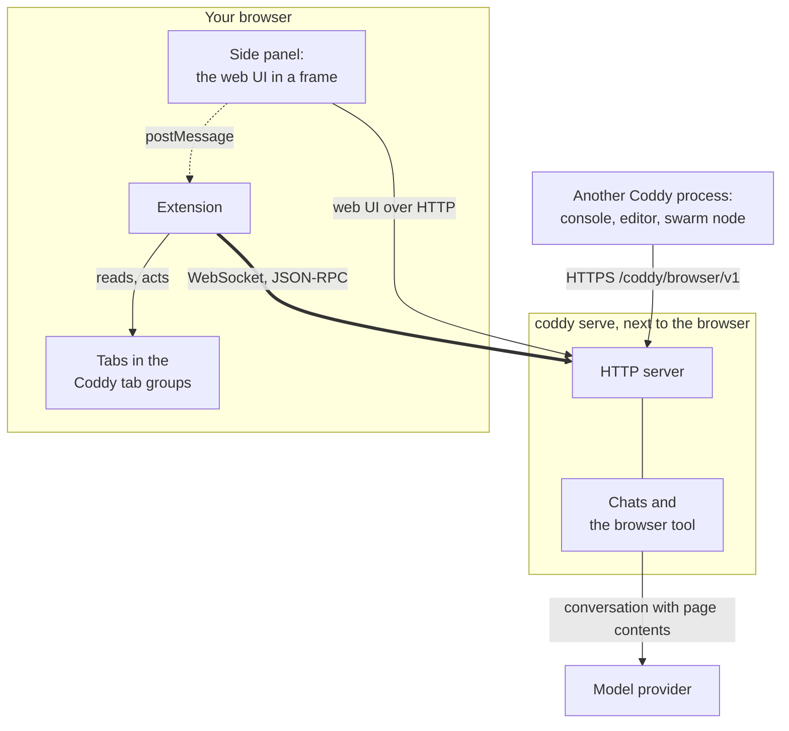
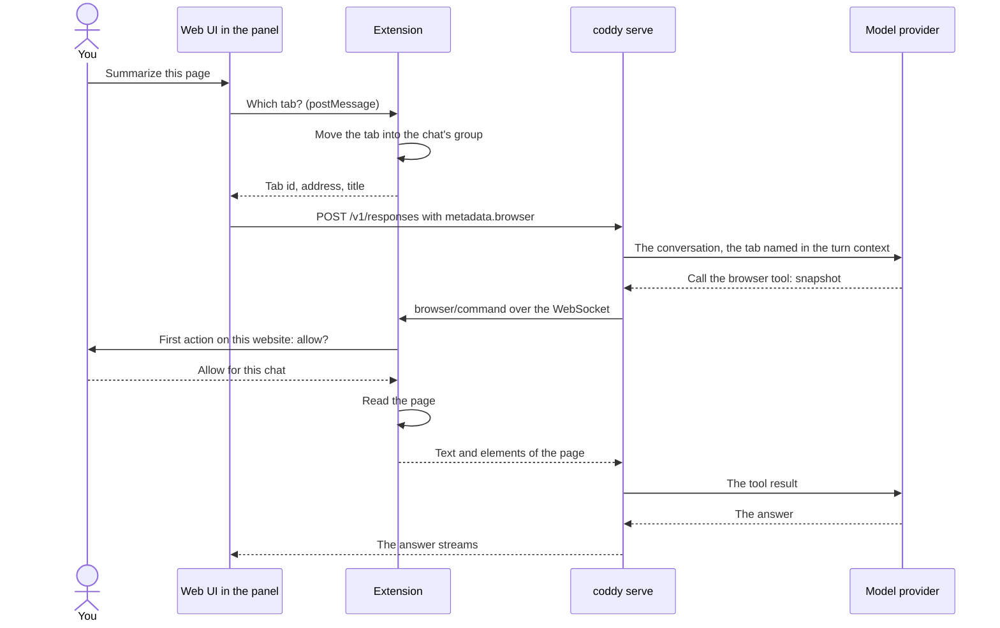
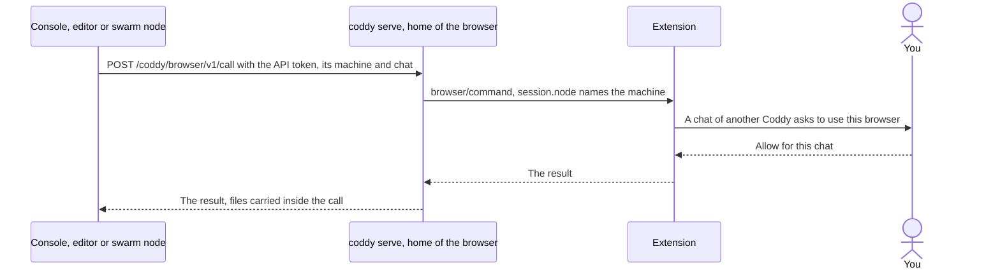

# Coddy for Browser

A browser extension for Chrome, Yandex Browser and Firefox that lets your own
[Coddy](https://github.com/coddy-project/coddy-agent) agent work in the browser you use every day. Chat with Coddy in
the side panel next to the page, or let a chat anywhere else in Coddy - the web UI, the console, an editor, Telegram,
a scheduled job, another machine of your swarm - use your browser: it opens a tab, reads the page, clicks, types,
takes screenshots and moves files, and the extension does it in the tabs you share.

[Русская версия](README.ru.md)

<p align="center">
  
</p>

The extension talks only to the Coddy server you point it at. The model runs on that server; the extension
executes the actions and asks you before Coddy touches a new website.

## How it works

### The parts



- **The extension dials out.** It opens one WebSocket to the HTTP server of `coddy serve`, its home server, and keeps
  it open. Coddy's actions travel down that socket as requests the extension answers, so Coddy reaches a browser it
  has no route to: a laptop behind NAT works the same as a browser on the server itself.
- **The side panel is the web UI.** The toolbar button opens the web UI of the same server beside the page, signed in
  by a one-time ticket the extension gets over its socket, with the whole composer - models, attachments, approval
  modes, history. The tab you write from goes into the chat's tab group before the message is sent, so "summarize
  this page" or "fill this form" works on the page in front of you.
- **Any chat of your Coddy can use it.** A console or an editor on the same machine, and the other nodes of your
  swarm, reach the browser through the home server's HTTP API (`browser.serve_remote`). The first action of such a
  chat asks you in the extension, naming the machine it runs on.
- **Tab groups decide what Coddy reaches.** Coddy sees only the tabs in its tab groups of the browser. You share a tab
  with every chat by pressing **Share** in the side panel, or by dragging it into the **Coddy** group. A chat that
  works in a shared tab moves it into a group of its own, titled after the chat, and no other chat may act there. A
  tab Coddy opens starts in the chat's group. Drag a tab out of a group, or press **Take back**, to take it back.
- **You approve websites.** Before the first action on a website, a small window of the extension asks: allow for
  this chat, always allow, or decline. "Always" covers the chats of the home server only: a chat from another
  machine asks for every new website. A page cannot answer these questions for you. Pages on your own machine
  (`localhost`, `127.0.0.1`, `[::1]`, any port) are on the list of sites allowed always from the start, except the
  Coddy server itself, whose web UI approves the chats' own requests; revoke them there like any other site.
- **You can stop it.** The Stop button on the page Coddy works in cancels every action, ungroups every tab and takes
  back what the chats from other machines were allowed; the tabs stay open. **Disconnect** on the settings page does
  the same and closes the connection.

### A turn from the side panel



### A chat of another Coddy process



### What goes where

| What | From | To | How |
| --- | --- | --- | --- |
| Coddy's actions and their results | `coddy serve` | the extension and back | the WebSocket the extension opened, JSON-RPC 2.0 |
| The extension key | the extension | its home server | in `initialize`, once per connection; kept in the extension's storage |
| The web UI of the panel | the home server | the panel's frame | the web UI's own HTTP, signed in by a one-time ticket from the socket |
| The tab you write from | the panel | the web UI, then the server | `postMessage` inside the browser, then `metadata.browser` of the message |
| Page text, elements and screenshots | the extension | the server, then the model provider | results of the `browser` tool |
| Files | a page or the workspace | the other one | one-time tickets under `/browser/v1/files/`, up to 32 MiB |
| Calls of another Coddy process | that process | the home server | HTTPS `/coddy/browser/v1` with the home server's API token |
| Your answers about websites and chats | - | - | they stay in the browser and never reach Coddy |

The wire protocol is documented in Coddy: [Browser protocol](https://coddy.dev/docs/reference/browser-protocol). The feature
from Coddy's side, with its configuration, is [Coddy for Browser](https://coddy.dev/docs/features/browser).

## Requirements

- A browser:
  - Chrome 116 or newer;
  - Yandex Browser, or another browser built on Chromium, from the same package as Chrome. Yandex Browser has no
    side panel, so the web UI opens in a window of its own beside the browser's;
  - Firefox 139 or newer, from the Firefox package. Firefox has no debugger API for extensions, so Coddy clicks and
    types through the page: a page can tell such input from a person's, and a site that checks for it (some editors,
    some sign-in forms) does not react.
- `coddy serve` built with the `browser` and `ui` tags, with its HTTP server on. The release binaries, the Docker image
  and the packages carry them.
- Coddy for Browser turned on in Coddy's `config.yaml`, with a key of at least 32 characters:

  ```yaml
  browser:
    enable: true
    token: ${CODDY_BROWSER_KEY}
    serve_remote: true   # optional: chats of a console, an editor or another node use this browser too
  ```

  Generate the key with `openssl rand -hex 32` and keep it in `<home>/.env` as `CODDY_BROWSER_KEY`. The extension
  connects to the HTTP server, the address the web UI has. Run `coddy serve` on the machine of the browser; for a
  server on another machine, put the HTTP server on HTTPS: the extension uses plain HTTP only for `localhost`,
  `127.0.0.1` and `[::1]`. A machine reachable only through your swarm joins it with `swarm.join`, and the other nodes
  reach its browser through the relay.

## Install

Every [release](https://github.com/coddy-project/coddy-for-browser/releases) carries the packages. Every run of the
[CI workflow](https://github.com/coddy-project/coddy-for-browser/actions/workflows/ci.yaml) keeps a build of each
family among its artifacts, `coddy-for-browser-chrome` and `coddy-for-browser-firefox`: the archive GitHub hands out is
the same package as the release's, unsigned (downloading an artifact needs a GitHub account).

| Package | Browsers |
| --- | --- |
| `coddy-for-browser-chrome-<version>.zip` | Chrome, Yandex Browser and other Chromium browsers |
| `coddy-for-browser-firefox-<version>.xpi` | Firefox, signed by Mozilla (in a release that was signed) |
| `coddy-for-browser-firefox-<version>.zip` | Firefox, unsigned |

### Chrome

1. Unpack `coddy-for-browser-chrome-<version>.zip` into a folder you keep.
2. Open `chrome://extensions`, turn on **Developer mode** and press **Load unpacked**. Choose the unpacked folder.

### Yandex Browser

1. Unpack `coddy-for-browser-chrome-<version>.zip` into a folder you keep.
2. Open `browser://extensions`, turn on **Developer mode** and press **Load unpacked**. Choose the unpacked folder.

The toolbar button opens the web UI in a window of its own, placed at the right edge of the browser's window.

### Firefox

- **Signed** (`.xpi`): open the file in Firefox, or drag it onto `about:addons`, and confirm the installation. Firefox
  keeps it like any add-on.
- **Unsigned** (`.zip`): release Firefox installs only add-ons Mozilla signed. Open
  `about:debugging#/runtime/this-firefox`, press **Load Temporary Add-on** and choose the archive; Firefox removes a
  temporary add-on when it closes. Firefox Developer Edition and Nightly keep the unsigned archive installed from
  `about:addons` (**Install Add-on From File**) once `xpinstall.signatures.required` is `false` in `about:config`.

The toolbar button opens the web UI in Firefox's sidebar.

### From source

Node.js 22 or newer, no packages to install:

```bash
npm run build
```

`dist/chrome` is the Chrome and Yandex Browser build, `dist/firefox` the Firefox one; load them as above.

## Connect

The settings page opens after the install, and later from the settings button of the side panel (or from the
extension's entry in the browser's list of extensions). Enter the server address (`http://127.0.0.1:12345` for a
local server, the address of its web UI), the key and a name for this browser, such as `Chrome - laptop`, then press
**Save and connect**. The name tells browsers apart when several are connected to one server: a chat lists them and
selects one.


The settings page shows the connection in its corner: green while connected, amber while it connects or retries,
grey while disconnected, red when the server refused the key or speaks another protocol version. **Disconnect** stops Coddy and closes the
connection.

## Use it

Press the toolbar button and write in the side panel, on the page you want Coddy to work with:

> Summarize this page and list the deadlines it mentions.

The panel is the web UI: the answer streams, the tool calls show as they run, Coddy's questions come up in the chat,
and the chat is an ordinary session you can continue anywhere. The strip over it shows the tab you look at and whose
it is, with **Share** and **Take back**, and the settings button, in the web UI's theme.

Open the panel on a tab a chat of your server works in, and the panel shows that chat: a turn started from the
console, an editor or a scheduled job streams there as in any chat. The chat's name in the strip opens it again.

From any other chat of Coddy, share a tab or let Coddy open one, and ask:

> Open the pull request list of coddy-project/coddy-agent and tell me which ones wait for review.

The chat calls the `browser` tool: it lists the tabs it may reach, reads a page as text with element references,
clicks and types (through the debugger in Chrome and Yandex Browser, so the input is trusted like a person's; through
the page in Firefox), and attaches screenshots when its model reads images. While Coddy works in a tab, the tab glows
and shows a Stop button, and the chat's group title starts with an hourglass.


Before the first action on a website, the extension asks in a window of its own, or in the side panel when it is
open:

<p align="center">
  
</p>

A chat of another Coddy process asks first, naming the machine it runs on:

<p align="center">
  
</p>

## Permissions

| Permission | Why |
| --- | --- |
| `tabs`, `tabGroups` | Read the tabs in the Coddy groups, open and group tabs for a chat. Firefox has tab groups from version 139. |
| `scripting` | Read a page and resolve element references; show the working indicator. |
| `debugger` | Chrome and Yandex Browser: trusted clicks, typing and keys, and screenshots through the DevTools protocol. The browser shows a bar while it is attached; the extension detaches 20 s after the last action. Firefox has no such API. |
| `storage` | The connection settings and the websites you allowed. The key is readable only by the extension's own pages. |
| `alarms` | Wake the service worker to reconnect after Chrome stopped it; Firefox keeps its background page running. |
| `notifications` | Tell you that Coddy asks to use a website. |
| `sidePanel` | Chrome: the web UI beside the page. Firefox takes a sidebar from the manifest instead, and Yandex Browser opens a window. |
| `http://*/*`, `https://*/*` | Act on the websites you allow, and reach your Coddy server. Firefox asks for `<all_urls>` instead, which its screenshot of a tab (`tabs.captureTab`) needs; the extension still acts on web pages only. |

The extension sends nothing anywhere but your Coddy server. Pages Coddy reads still reach the model provider your
Coddy server is configured with.

## Develop

```bash
npm test                      # unit tests, Node only
npm run build                 # dist/chrome, dist/firefox and their archives
npm i --no-save playwright    # once, for the Chromium run
npx playwright install chromium
npm run e2e                   # the Chrome build in a real Chromium against a mock of Coddy
npm i --no-save puppeteer-core
npm run e2e:firefox           # the Firefox build in a real Firefox against the same mock
```

`CODDY_BROWSER_PATH` points the Chromium run at an installed browser instead of Playwright's Chromium - Google Chrome,
Yandex Browser - which gets the extension through the DevTools protocol, since branded browsers ignore
`--load-extension`. `CODDY_FIREFOX_PATH` names the Firefox of the Firefox run. `CODDY_SCREENSHOT_DIR` collects
screenshots of the extension's pages.

The [CI workflow](.github/workflows/ci.yaml) runs the unit tests, builds both packages as artifacts and runs both
end-to-end runs on every push and pull request. A `v<version>` tag publishes a release with the packages attached; with
the `AMO_JWT_ISSUER` and `AMO_JWT_SECRET` secrets (an API key of addons.mozilla.org) it also signs the Firefox build as
an unlisted add-on and attaches the `.xpi` (`scripts/sign.mjs`).

| File | What it does |
| --- | --- |
| `src/background.js` | The background (a service worker in Chrome, a page in Firefox): wiring, the messages of the side panel, the approval window and the settings page. |
| `src/platform.js` | What the browser offers: the side panel, the sidebar, the debugger. |
| `src/panel.js`, `src/frame.js` | The side panel: the web UI in a frame, signed in by its ticket, and the bridge that gives a turn its tab and takes the web UI's theme. |
| `src/connection.js` | The WebSocket, `initialize`, keepalive and reconnects. |
| `src/rpc.js` | The JSON-RPC 2.0 peer. |
| `src/commands.js` | Every action Coddy asks for, with the checks before it. |
| `src/groups.js` | The Coddy tab groups and who holds which tab. |
| `src/approvals.js`, `src/policy.js` | Website approvals and address checks. |
| `src/page.js`, `src/input.js`, `src/pageinput.js`, `src/indicator.js` | What runs in a page, input through the DevTools protocol (Chrome) or through the page (Firefox), the working indicator. |
| `scripts/build.mjs`, `scripts/sign.mjs` | The build of each browser family (the Firefox manifest is Manifest V2) and the signing of the Firefox one. |

A change to the protocol goes to both repositories: the extension and `external/browser` in coddy-agent, with the
protocol page updated in the same change.

## License

MIT, see [LICENSE](LICENSE).
