<p align="center">
  
</p>

<h1 align="center">Coddy for Browser</h1>

<p align="center">
  <b>Ваш собственный агент <a href="https://github.com/coddy-project/coddy-agent">Coddy</a> в браузере, которым вы пользуетесь каждый день.</b>
  <br>
  Chrome · Яндекс Браузер · Firefox · Firefox для Android
</p>

<p align="center">
  <a href="https://github.com/coddy-project/coddy-for-browser/releases/latest"></a>
  <a href="https://github.com/coddy-project/coddy-for-browser/actions/workflows/ci.yaml"></a>
  <a href="LICENSE"></a>
</p>

<p align="center">
  <b>Установить для <a href="https://chromewebstore.google.com/detail/coddy-for-browser/pdppgelbaehcedjpgfonemkmglpjifni">Chrome и Яндекс Браузера</a> · <a href="https://addons.mozilla.org/firefox/addon/coddy-for-browser/">Firefox и Firefox для Android</a></b>
</p>

<p align="center">
  <a href="README.md">English</a> · <b>Русский</b>
</p>

<picture>
  <source media="(prefers-color-scheme: dark)" srcset="docs/screenshots/chrome-panel-dark-1280.png">
  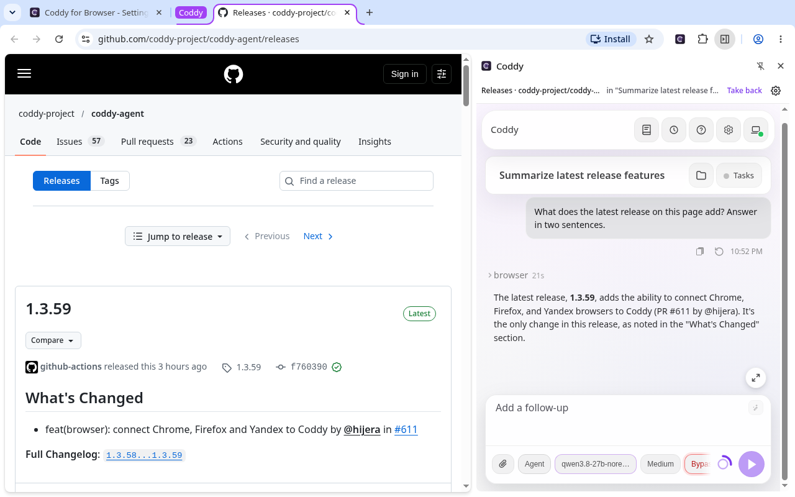
</picture>

Расширение, через которое ваш собственный агент Coddy работает в браузере, которым вы пользуетесь каждый день. С Coddy
можно переписываться в боковой панели рядом со страницей, а можно дать браузер любому другому чату Coddy - в
веб-интерфейсе, консоли, редакторе, Telegram, задании планировщика или на другой машине вашего роя. Чат открывает
вкладку, читает страницу, кликает, печатает, делает скриншоты и переносит файлы, а расширение выполняет это во
вкладках, которые вы ему дали.

Расширение общается только с сервером Coddy, адрес которого вы указали. Модель работает на этом сервере, расширение
выполняет действия и спрашивает вас, прежде чем Coddy впервые возьмётся за новый сайт.

## Возможности

- **Веб-интерфейс рядом со страницей.** Кнопка расширения открывает веб-интерфейс вашего сервера в боковой панели
  Chrome, в сайдбаре Firefox или в отдельном окне в Яндекс Браузере, а на телефоне его открывает во вкладке пункт
  расширения в меню браузера. Поле ввода там целиком, с моделями, вложениями, режимами разрешений и историей;
- **страница перед вами.** Вкладка, из которой вы пишете, уходит вместе с сообщением, поэтому просьбы "перескажи эту
  страницу" или "заполни эту форму" работают с ней;
- **любой чат вашего Coddy.** Чат в Telegram или задание планировщика на том же сервере работают в браузере так же,
  как боковая панель. Консоль, редактор или другой узел роя сначала спрашивают вас и называют машину, на которой
  работают;
- **только те вкладки, что вы дали.** Coddy видит вкладки в своих группах, то есть те, что вы дали, и те, что открыл
  чат;
- **вопрос перед каждым новым сайтом.** Разрешить для чата, разрешить всегда или отказать. Страница ответить за вас
  не может;
- **клики, ввод и файлы.** А ещё клавиши, наведение, прокрутка, перетаскивание, скриншоты и файлы в обе стороны. В
  Chrome и Яндекс Браузере ввод идёт через отладчик, поэтому страницы доверяют ему, как вводу человека;
- **кнопка Stop на странице.** Она отменяет все действия и распускает все группы, а вкладки остаются открытыми.

## Браузеры

| Браузер | Версия | Где открывается веб-интерфейс | Как идут клики и ввод |
| --- | --- | --- | --- |
| Chrome | 116 или новее | в боковой панели | через отладчик |
| Яндекс Браузер и другие браузеры на Chromium | Chromium 116 или новее | в боковой панели, а где её нет (Яндекс Браузер), в отдельном окне рядом с окном браузера | через отладчик |
| Firefox | 140 или новее | в сайдбаре | через страницу |
| Firefox для Android | 142 или новее | во вкладке | через страницу |

API отладчика у расширений Firefox нет, поэтому там Coddy кликает и печатает через страницу. Страница может отличить
такой ввод от ввода человека, и сайт, который это проверяет (некоторые редакторы и формы входа), на него не
отзывается. В Firefox для Android у расширений нет ещё и групп вкладок, сайдбара и окон, поэтому группы вкладок
расширение ведёт само, а веб-интерфейс и вопросы о сайтах открываются во вкладках.

## Быстрый старт

1. **Включите браузер в Coddy.** Нужен `coddy serve`, собранный с тегами `browser` и `ui`, с включённым HTTP-сервером.
   Эти теги есть в бинарниках релиза, в Docker-образе и в пакетах. Добавьте в `config.yaml` Coddy

   ```yaml
   browser:
     enable: true
     token: ${CODDY_BROWSER_KEY}
     serve_remote: true   # по желанию: браузером пользуются и чаты консоли, редактора или другого узла
   ```

   Ключ не короче 32 символов сгенерируйте командой `openssl rand -hex 32` и положите в `<home>/.env` как
   `CODDY_BROWSER_KEY`. Запускайте `coddy serve` на машине с браузером. Серверу на другой машине нужен HTTPS, потому
   что простой HTTP расширение принимает только для `localhost`, `127.0.0.1` и `[::1]`;
2. **[установите](#установка) расширение** из магазина вашего браузера;
3. **[подключитесь](#подключение).** На странице настроек, которая открывается после установки, введите адрес
   веб-интерфейса сервера (`http://127.0.0.1:12345` для локального сервера), ключ и имя этого браузера и нажмите
   **Save and connect**;
4. **спросите.** Нажмите кнопку расширения на странице и напишите в боковой панели, например "Перескажи эту страницу и
   перечисли сроки, которые в ней упомянуты".

Сторона Coddy со всеми настройками описана на странице [Coddy for Browser](https://coddy.dev/docs/features/browser).
Машина, до которой можно добраться только через рой, входит в него через `swarm.join`, и другие узлы обращаются к её
браузеру через релей.

## Установка

| Браузер | Откуда установить |
| --- | --- |
| Chrome, Яндекс Браузер и совместимые браузеры на Chromium | [Chrome Web Store](https://chromewebstore.google.com/detail/coddy-for-browser/pdppgelbaehcedjpgfonemkmglpjifni) |
| Firefox и Firefox для Android | [Firefox Add-ons](https://addons.mozilla.org/firefox/addon/coddy-for-browser/) |

Firefox на компьютере и на Android используют одну страницу дополнения и один пакет. Установка с AMO доступна после
того, как Mozilla опубликует совместимую версию. Нужен Firefox для Android 142 или новее. Откройте ссылку Firefox
Add-ons в Firefox на том устройстве, куда хотите поставить расширение.

### Обновления

Если автоматические обновления включены, браузер обновляет расширение из своего магазина, когда там выходит новая
версия. Релиз на GitHub может появиться раньше, чем магазины закончат проверку. Браузер получает версию из магазина,
а не ZIP из релиза GitHub. Механизм описан в документации
[Chrome](https://developer.chrome.com/docs/extensions/develop/concepts/extensions-update-lifecycle) и
[Firefox](https://extensionworkshop.com/documentation/manage/updating-your-extension/) (на английском).

Chrome может отложить установку скачанного обновления, пока открыта боковая панель или соединение с Coddy. Если
обновление ждёт, перезапустите Chrome. Распакованные сборки для Chromium и временные дополнения Firefox не получают
обновления из магазинов. Замените распакованные файлы и перезагрузите расширение либо вручную загрузите новый архив
Firefox.

### Пакеты для ручной установки

Пакеты прикреплены к каждому [релизу](https://github.com/coddy-project/coddy-for-browser/releases), а сам релиз
уходит ещё в Chrome Web Store и на addons.mozilla.org, которые публикуют его после своей проверки. Ссылки на страницы
в магазинах есть в заметках к релизу. Каждый прогон
[CI](https://github.com/coddy-project/coddy-for-browser/actions/workflows/ci.yaml) сохраняет сборку для каждого
семейства браузеров в артефактах `coddy-for-browser-chrome` и `coddy-for-browser-firefox`. Архив, который отдаёт
GitHub, - тот же пакет, что и в релизе (чтобы скачать артефакт, нужна учётная запись GitHub).

| Пакет | Браузеры |
| --- | --- |
| `coddy-for-browser-chrome-<version>.zip` | Chrome, Яндекс Браузер и другие браузеры на Chromium |
| `coddy-for-browser-firefox-<version>.zip` | Firefox и Firefox для Android, без подписи |

### Chrome

Установите расширение из [Chrome Web Store](https://chromewebstore.google.com/detail/coddy-for-browser/pdppgelbaehcedjpgfonemkmglpjifni).
Для разработки или ручной установки выполните следующие шаги.

1. Распакуйте `coddy-for-browser-chrome-<version>.zip` в папку, которую не удалите.
2. Откройте `chrome://extensions`, включите **Режим разработчика** и нажмите **Загрузить распакованное расширение**,
   затем выберите эту папку.

### Яндекс Браузер

Установите расширение с той же [страницы Chrome Web Store](https://chromewebstore.google.com/detail/coddy-for-browser/pdppgelbaehcedjpgfonemkmglpjifni).
Для разработки или ручной установки выполните следующие шаги.

1. Распакуйте `coddy-for-browser-chrome-<version>.zip` в папку, которую не удалите.
2. Откройте `browser://extensions`, включите **Режим разработчика** и нажмите **Загрузить распакованное расширение**,
   затем выберите эту папку.

Кнопка расширения на панели открывает веб-интерфейс в отдельном окне у правого края окна браузера.

### Firefox

- **С [Firefox Add-ons](https://addons.mozilla.org/firefox/addon/coddy-for-browser/)**, когда версия там опубликована.
  Устанавливается как любое другое дополнение, обновляется через Firefox;
- **без подписи** (`.zip`). Обычный Firefox ставит только дополнения, подписанные Mozilla. Откройте
  `about:debugging#/runtime/this-firefox`, нажмите **Загрузить временное дополнение** и выберите архив. Временное
  дополнение Firefox удаляет при закрытии. Firefox Developer Edition и Nightly оставляют архив без подписи
  установленным, если поставить его со страницы `about:addons` (**Установить дополнение из файла**) после того, как
  в `about:config` параметр `xpinstall.signatures.required` выставлен в `false`.

Кнопка расширения на панели открывает веб-интерфейс в боковой панели Firefox.

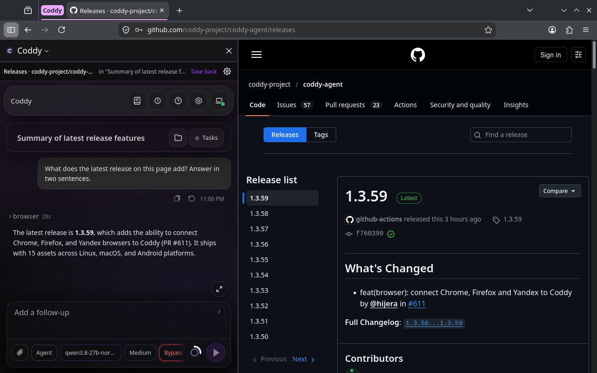

### Firefox для Android

- **С [Firefox Add-ons](https://addons.mozilla.org/firefox/addon/coddy-for-browser/)**, когда совместимая версия там
  опубликована. Откройте ту же страницу в Firefox для Android и установите дополнение либо найдите его через пункт
  **Расширения** в меню браузера;
- **без подписи**, для разработки. Обычный Firefox для Android ставит дополнения только с addons.mozilla.org, а
  `web-ext` устанавливает сборку на телефон или эмулятор через `adb`. На телефоне для этого нужна отладка по USB, а
  в настройках Firefox удалённая отладка.

  ```bash
  npx web-ext run --target firefox-android --source-dir dist/firefox --android-device <adb id>
  ```

Пункт расширения в разделе **Расширения** меню браузера открывает веб-интерфейс в отдельной вкладке. Кнопки **Share** и
**Take back** там действуют на страницу, открытую последней. Вопрос о сайте выводит вперёд открытый веб-интерфейс или
открывается в отдельной вкладке, которая закрывается после ответа.

### Из исходников

Нужен Node.js 22 или новее, пакеты ставить не надо.

```bash
npm run build
```

`dist/chrome` - сборка для Chrome и Яндекс Браузера, `dist/firefox` - для Firefox и Firefox для Android. Загрузите их
так же, как описано выше.

## Подключение

Страница настроек открывается после установки, а позже по кнопке настроек в боковой панели (или из строки расширения
в списке расширений браузера). Введите адрес сервера (`http://127.0.0.1:12345` для локального сервера, тот же, что у
его веб-интерфейса), ключ и имя этого браузера, например `Chrome - laptop`, и нажмите **Save and connect**. Имя
различает браузеры, когда к одному серверу подключено несколько, и чат выбирает среди них.

<picture>
  <source media="(prefers-color-scheme: dark)" srcset="docs/screenshots/settings-dark-1280.png">
  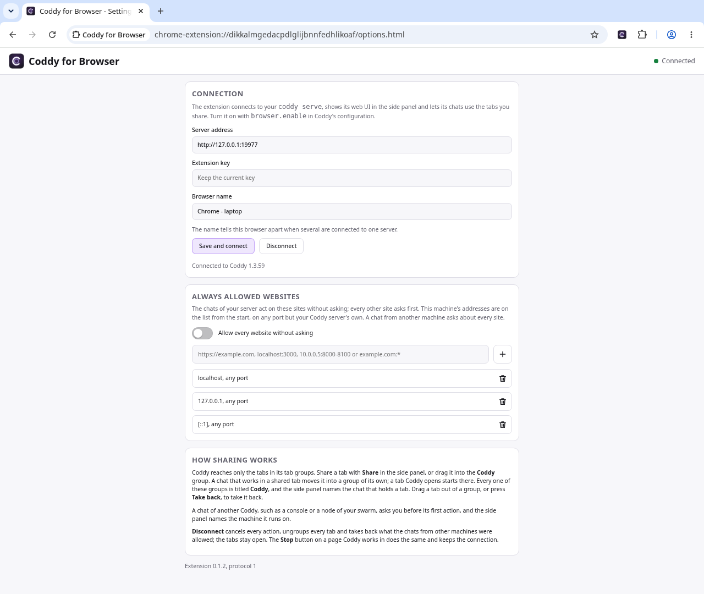
</picture>

В углу страницы настроек видно состояние подключения. Зелёная точка значит, что расширение подключено, жёлтая - что
оно подключается или повторяет попытку, серая - что подключение выключено, красная - что сервер отклонил ключ или
работает с другой версией протокола. **Disconnect** останавливает Coddy и закрывает подключение.

### Телефон с Firefox для Android

<table>
  <tr>
    <td width="33%">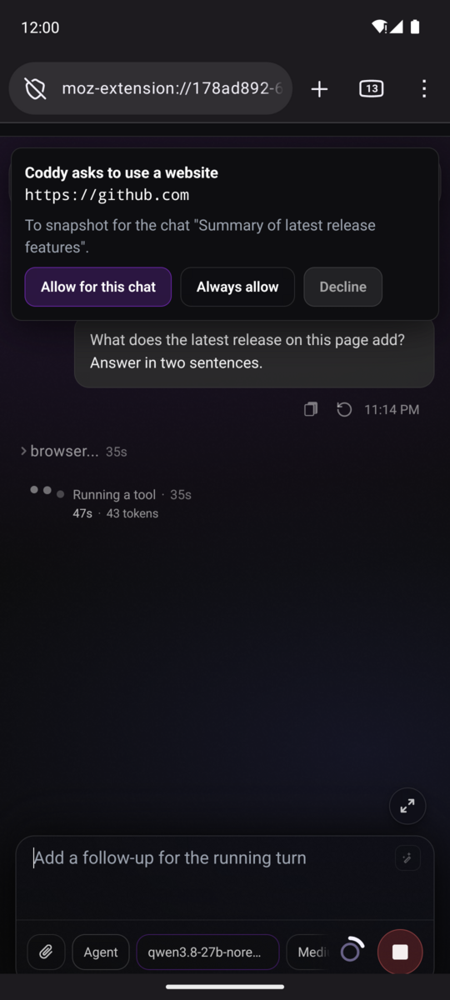</td>
    <td width="33%">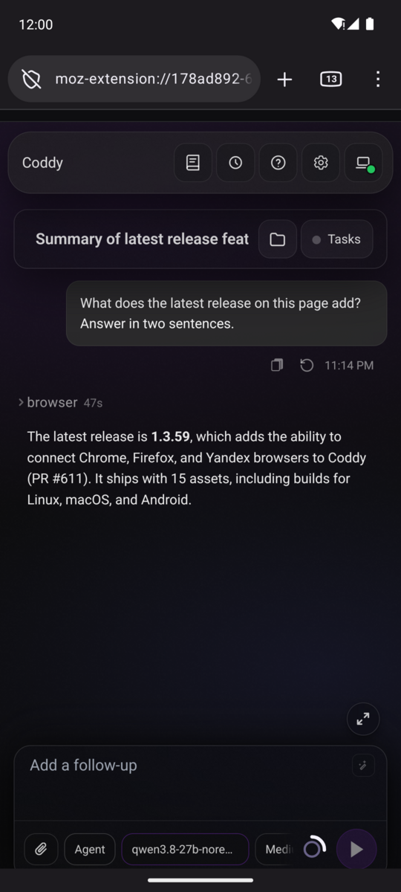</td>
    <td width="33%">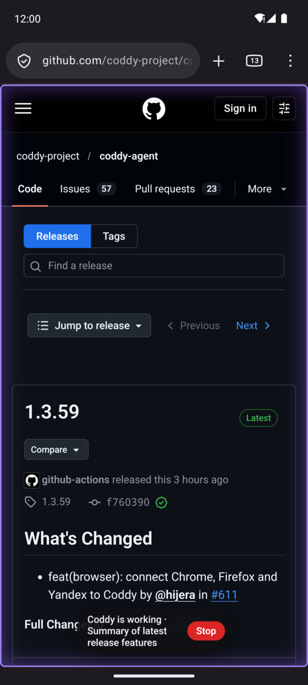</td>
  </tr>
</table>

Расширение на телефоне подключается к серверу Coddy так же, и вариантов здесь три. Во всех страница настроек
открывается из раздела **Расширения** в меню браузера (пункт **Coddy for Browser**, затем кнопка настроек в панели),
а веб-интерфейс открывается из того же пункта в отдельной вкладке. Coddy продолжает работать и со свёрнутым Firefox,
когда впереди Termux или другое приложение. Вопрос о сайте или чате при этом ждёт в Firefox, поэтому разрешите Firefox
показывать уведомления, когда Android спросит, и уведомление вам о нём скажет. Страница, в которую Coddy кликает или
которую снимает, сначала выходит вперёд, потому что Firefox для Android раскладывает и снимает только вкладку на
переднем плане.

<details>
<summary><b>Coddy на самом телефоне</b>, в Termux</summary>

`coddy serve` работает в [Termux](https://termux.dev), а расширение подключается к нему через loopback телефона, так
что за пределы телефона уходят только запросы к модели. Поставьте Termux (из F-Droid, со страницы релизов на GitHub или
из Google Play) и выполните в нём

```bash
pkg install curl tmux
curl -fsSL https://coddy.dev/install.sh | bash
source ~/.bashrc
```

Включите браузер в `~/.coddy/config.yaml` рядом с провайдером и моделью из
[Настройки](https://coddy.dev/docs/getting-started/configuration).

```yaml
browser:
  enable: true
  token: ${CODDY_BROWSER_KEY}
```

Запишите `CODDY_BROWSER_KEY=<openssl rand -hex 32>` в `~/.coddy/.env`, запустите сервер командами
`termux-wake-lock` и `tmux new -s coddy 'coddy serve'`, а на странице настроек расширения введите
`http://127.0.0.1:12345` и ключ. Разрешите Termux работать без ограничений в настройках батареи Android, иначе система
остановит сервер, когда погаснет экран ([Android (Termux)](https://coddy.dev/docs/getting-started/android)).

</details>

<details>
<summary><b>Coddy на другой машине</b>, за HTTPS</summary>

`coddy serve` на ноутбуке или сервере управляет браузером телефона по сети. Простой HTTP расширение принимает только
для loopback самого телефона, поэтому серверу нужен HTTPS. Своего TLS у `coddy serve` нет, его даёт прокси перед
HTTP-сервером (Caddy, nginx). На странице настроек введите адрес прокси, например `https://coddy.example.com`, и
`browser.token` сервера.

Сертификат публичного центра работает сразу. Для сертификата собственного центра на телефоне нужны два шага. Сначала
установите сертификат центра в Android как сертификат ЦС (раздел **Шифрование и учётные данные** в настройках
безопасности, в разных версиях Android он называется чуть по-разному), затем включите **Use third party CA
certificates** в **Secret Settings** Firefox. Этот раздел появляется после пяти нажатий на логотип Firefox в
**Settings**, **About Firefox**. С `browser.serve_remote: true` до браузера телефона дотягиваются и чаты консоли,
редакторов и узлов роя этого сервера, каждый из них сначала спрашивает разрешения на телефоне.

</details>

<details>
<summary><b>Телефон как узел роя</b></summary>

Coddy в Termux подключается к релею на ноутбуке или сервере через `swarm.join`, как в
[Телефоны на Android как узлы роя](https://coddy.dev/docs/tutorials/swarm-android-nodes), а расширение подключается к
собственному `coddy serve` телефона через loopback, как в первом варианте. Соединение открывает телефон, поэтому ему
не нужны ни публичный адрес, ни открытый порт, и через это соединение телефоном управляют веб-интерфейс и консоль
релея. Ход, начатый там на телефоне, выполняется на телефоне и пользуется его браузером, как любой чат сервера
телефона. Другие машины роя достают до браузера телефона через релей по адресу
`<релей>/swarm/nodes/<телефон>/coddy/browser/v1/...`, если у телефона включён `browser.serve_remote: true`, и каждый их
чат сначала спрашивает разрешения на телефоне. Вот `~/.coddy/config.yaml` телефона.

```yaml
httpserver:
  enable: true
  auth_token: ${NODE_TOKEN}
browser:
  enable: true
  token: ${CODDY_BROWSER_KEY}
  serve_remote: true
swarm:
  join:
    - url: https://relay.example.com:12346
      name: pixel
      pairing_token: ${SWARM_PAIRING_TOKEN}
      token: ${NODE_TOKEN}
```

</details>

## Работа

Нажмите кнопку расширения и напишите в боковой панели, находясь на странице, с которой должен работать Coddy.

> Перескажи эту страницу и перечисли сроки, которые в ней упомянуты.

Панель - это веб-интерфейс. Ответ приходит по мере генерации, вызовы инструментов видны по мере выполнения, вопросы
Coddy появляются в чате, а сам чат - обычная сессия, которую можно продолжить где угодно. Полоска над ним показывает
вкладку, на которую вы смотрите, и в чьей группе она находится, кнопки **Share** и **Take back** и кнопку настроек, в
теме веб-интерфейса.

Если открыть панель на вкладке, в которой работает чат вашего сервера, панель покажет этот чат. Ход, начатый из
консоли, редактора или задания планировщика, идёт там потоком, как в любом чате, а имя чата в полоске снова
открывает его.

Из любого другого чата Coddy дайте вкладку или позвольте Coddy открыть её самому и попросите, например так.

> Открой список пул-реквестов coddy-project/coddy-agent и скажи, какие ждут ревью.

Чат вызывает инструмент `browser`. Он смотрит доступные вкладки, читает страницу как текст со ссылками на элементы,
кликает и печатает (в Chrome и Яндекс Браузере через отладчик, поэтому ввод доверенный, как у человека, а в Firefox
через страницу) и прикладывает скриншоты, если модель чата читает изображения. Пока Coddy работает во вкладке, она
подсвечена и показывает кнопку Stop, а название группы чата начинается с песочных часов.

<picture>
  <source media="(prefers-color-scheme: dark)" srcset="docs/screenshots/working-tab-dark-1280.png">
  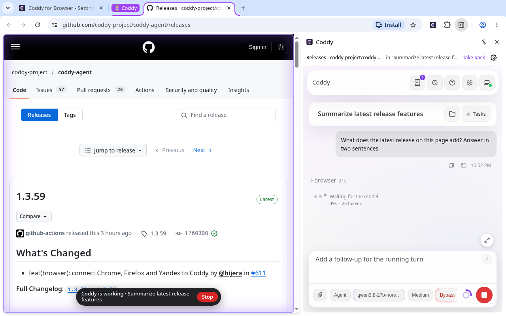
</picture>

### Вопросы перед действиями Coddy

Перед первым действием на сайте расширение спрашивает в собственном окне, а если боковая панель открыта, то в ней. В
Chrome и Яндекс Браузере первое разрешение сайта вызывает ещё и собственный запрос браузера для этого сайта. Так же
бывает, когда вы добавляете сайт на странице настроек, включаете переключатель для любого сайта или сохраняете адрес
сервера Coddy на другой машине. Firefox пускает расширение на все сайты сразу после установки, а решает только вопрос
самого расширения.

<table>
  <tr>
    <td width="53%">
      <picture>
        <source media="(prefers-color-scheme: dark)" srcset="docs/screenshots/site-approval-dark-510.png">
        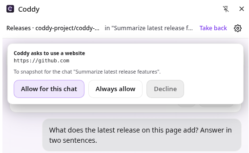
      </picture>
    </td>
    <td width="47%">
      <picture>
        <source media="(prefers-color-scheme: dark)" srcset="docs/screenshots/chrome-site-access-dark-448.png">
        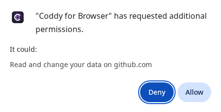
      </picture>
    </td>
  </tr>
</table>

Чат другого процесса Coddy сначала спрашивает разрешения и называет машину, на которой работает.

<p align="center">
  <picture>
    <source media="(prefers-color-scheme: dark)" srcset="docs/screenshots/remote-chat-dark-510.png">
    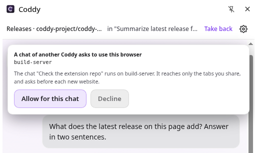
  </picture>
</p>

## Безопасность и приватность

- **Что видит Coddy, решают группы вкладок.** Coddy видит только вкладки в своих группах браузера. Чтобы дать вкладку
  всем чатам, нажмите **Share** в боковой панели или перетащите вкладку в группу **Coddy**. Чат, который начал
  работать в общей вкладке, переносит её в собственную группу, и другие чаты там действовать не могут. Вкладка,
  которую открыл Coddy, сразу попадает в группу чата. Все эти группы называются **Coddy** и окрашены в фиолетовый, а
  боковая панель показывает, какому чату принадлежит вкладка перед вами. Чтобы забрать вкладку, вытащите её из группы
  или нажмите **Take back**. В Firefox для Android групп вкладок нет, поэтому расширение ведёт их само. Вкладку там
  дают и забирают кнопками **Share** и **Take back** в панели, а панель называет чат, которому принадлежит страница,
  открытая последней;
- **сайты одобряете вы.** Перед первым действием на сайте расширение спрашивает, разрешить ли его для этого чата,
  разрешить всегда или отказать. "Всегда" действует только для чатов домашнего сервера, а чат с другой машины
  спрашивает про каждый новый сайт. Страница не может ответить на эти вопросы за вас. Страницы на вашей машине
  (`localhost`, `127.0.0.1`, `[::1]`, любой порт) с самого начала стоят в списке сайтов, разрешённых всегда, кроме
  самого сервера Coddy, в веб-интерфейсе которого одобряются запросы чатов. Убрать их из списка можно, как любой
  другой сайт. На странице настроек адреса можно добавить заранее - origin (`https://example.com`), порт
  (`localhost:3000`), диапазон портов (`10.0.0.5:8000-8100`) или все порты (`example.com:*`), - а переключатель
  разрешает чатам вашего сервера любой сайт. Для самого сервера Coddy всё равно нужна запись с его портом. Chrome и
  Яндекс Браузер после вашего согласия один раз на каждый сайт показывают и собственный запрос, потому что при
  установке расширение получает доступ только к адресам этой машины, а к остальным сайтам получает его через этот
  запрос;
- **остановить можно в любой момент.** Кнопка Stop на странице, где работает Coddy, отменяет все действия,
  распускает все группы и отзывает разрешения чатов с других машин, а вкладки остаются открытыми. **Disconnect** на
  странице настроек делает то же самое и закрывает подключение;
- **только ваш сервер.** Расширение ничего не отправляет никуда, кроме вашего сервера Coddy. Страницы, которые читает
  Coddy, всё равно попадают к провайдеру модели, настроенному на вашем сервере. Что уходит на сервер и что остаётся в
  браузере, перечислено в [политике конфиденциальности](PRIVACY.md) (на английском).

### Разрешения

| Разрешение | Зачем |
| --- | --- |
| `tabs`, `tabGroups` | Читать вкладки в группах Coddy, открывать и группировать вкладки для чата. Группы вкладок есть в Firefox начиная с версии 139. В Firefox для Android их нет, и группы расширение ведёт само. |
| `scripting` | Читать страницу и находить элементы по ссылкам, показывать индикатор работы. |
| `debugger` | В Chrome и Яндекс Браузере - доверенные клики, ввод текста и клавиш, скриншоты через протокол DevTools. Пока отладчик подключён, браузер показывает полосу, а расширение отключается через 20 с после последнего действия. В Firefox такого API нет. |
| `storage` | Настройки подключения и сайты, которые вы разрешили. Ключ доступен только страницам самого расширения. |
| `alarms` | Будить service worker, чтобы переподключиться после того, как Chrome его остановил. В Firefox фоновая страница работает постоянно. |
| `notifications` | Сообщить, что Coddy просит доступ к сайту. |
| `sidePanel` | В Chrome - веб-интерфейс рядом со страницей. Firefox берёт боковую панель из манифеста, Яндекс Браузер открывает окно, а Firefox для Android вкладку. |
| `localhost`, `127.0.0.1`, `[::1]` | Достучаться до сервера Coddy на этой машине и действовать на её страницах, которые с самого начала стоят в списке сайтов, разрешённых всегда. |
| `http://*/*`, `https://*/*`, опционально | В Chrome и Яндекс Браузере - действовать на сайте после того, как вы его разрешили, и достучаться до сервера Coddy на другой машине после сохранения его адреса. Каждый такой доступ браузер выдаёт один раз в собственном запросе, при установке расширение не получает ничего за пределами этой машины. Firefox вместо этого с установки держит `<all_urls>`, без которого не работает его скриншот вкладки (`tabs.captureTab`); действует расширение по-прежнему только на веб-страницах и только после своего вопроса. |

## Как это устроено

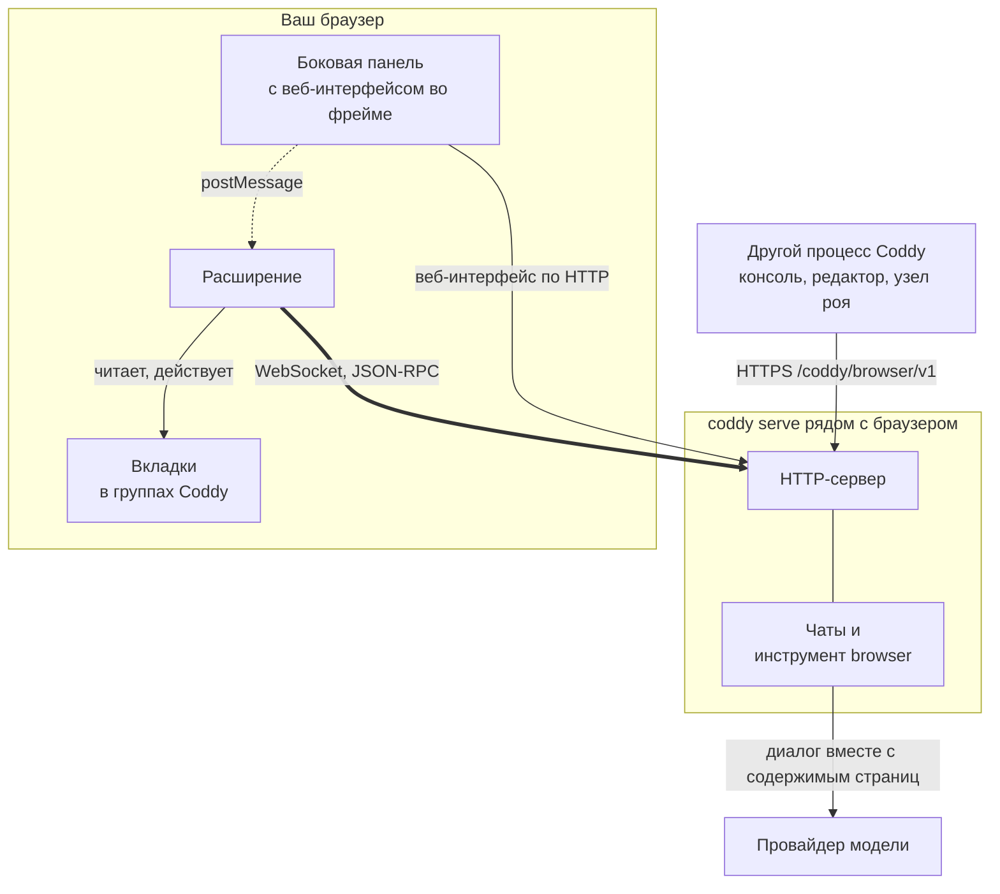

- **Соединение открывает расширение.** Оно держит один WebSocket к HTTP-серверу `coddy serve`, своему домашнему
  серверу. Действия Coddy приходят по этому сокету запросами, на которые расширение отвечает, поэтому Coddy
  добирается до браузера, к которому у сервера нет маршрута, и ноутбук за NAT работает так же, как браузер на самом
  сервере;
- **боковая панель - это веб-интерфейс.** Кнопка расширения на панели открывает рядом со страницей веб-интерфейс того
  же сервера. Вход выполняется по одноразовому тикету, который расширение получает по своему сокету. Вкладка, из
  которой вы пишете, попадает в группу чата ещё до отправки сообщения;
- **браузером пользуется любой чат вашего Coddy.** Консоль или редактор на той же машине и другие узлы роя
  обращаются к браузеру через HTTP API домашнего сервера (`browser.serve_remote`). Перед первым действием такого чата
  расширение спрашивает вас и называет машину, на которой он работает.

<details>
<summary><b>Ход из боковой панели</b></summary>

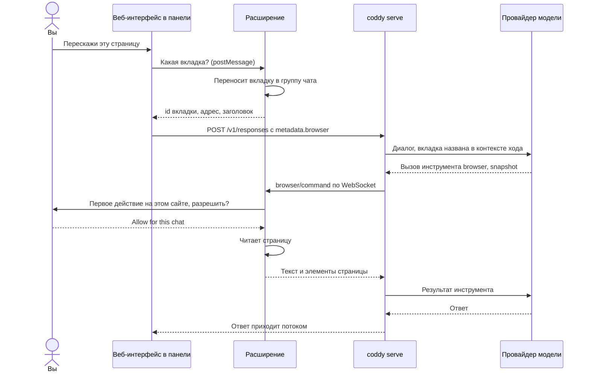

</details>

<details>
<summary><b>Чат другого процесса Coddy</b></summary>

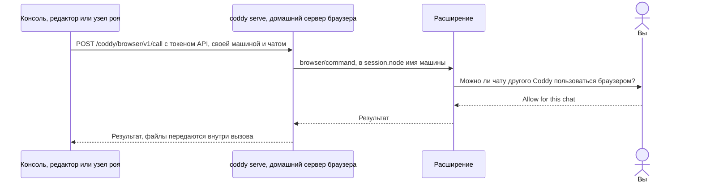

</details>

### Что куда передаётся

| Что | Откуда | Куда | Как |
| --- | --- | --- | --- |
| Действия Coddy и их результаты | `coddy serve` | в расширение и обратно | WebSocket, который открыло расширение, JSON-RPC 2.0 |
| Ключ расширения | расширение | его домашний сервер | в `initialize`, один раз на подключение; хранится в хранилище расширения |
| Веб-интерфейс панели | домашний сервер | фрейм панели | обычный HTTP веб-интерфейса, вход по одноразовому тикету из сокета |
| Вкладка, из которой вы пишете | панель | веб-интерфейс, затем сервер | `postMessage` внутри браузера, затем `metadata.browser` в сообщении |
| Текст страницы, элементы и скриншоты | расширение | сервер, затем провайдер модели | результаты инструмента `browser` |
| Файлы | страница или рабочая папка | другая сторона | одноразовые тикеты под `/browser/v1/files/`, до 32 МиБ |
| Вызовы другого процесса Coddy | этот процесс | домашний сервер | HTTPS `/coddy/browser/v1` с API-токеном домашнего сервера |
| Ваши ответы про сайты и чаты | - | - | остаются в браузере и до Coddy не доходят |

Протокол описан в документации Coddy на странице [Протокол браузера](https://coddy.dev/docs/reference/browser-protocol).
Сторона Coddy и её настройка описаны на странице [Coddy for Browser](https://coddy.dev/docs/features/browser).

## Если что-то не работает

**Страница настроек пишет "Coddy refused the extension key".** Ключ не совпадает с `browser.token` сервера. Вставьте
значение `CODDY_BROWSER_KEY` в поле **Extension key** и нажмите **Save and connect**. Пустое поле оставляет ключ,
сохранённый раньше.

**Страница настроек пишет "This Coddy speaks another protocol version".** Расширение и сервер говорят на разных
версиях протокола. Обновите более старый из двух.

**Состояние долго жёлтое, "Disconnected; retrying in N s".** Расширение не достаёт до сервера. Проверьте, что
`coddy serve` запущен, что адрес совпадает с адресом его веб-интерфейса и что при старте сервер вывел строку `browser`
с `/browser/v1/connect`. Если такой строки нет, `browser.enable` выключен в той конфигурации, которую читает сервер.

**При сохранении адреса появляется "Use HTTPS for a Coddy server on another machine".** Простой HTTP расширение
принимает только для этой машины. Поставьте перед HTTP-сервером прокси с TLS, как для
[телефона](#телефон-с-firefox-для-android).

**Chrome показывает полосу о том, что Coddy for Browser начал отладку браузера.** Так Chrome отмечает отладчик, через
который расширение кликает и печатает. Полоса пропадает через 20 с после последнего действия.

**Сайт в Firefox не реагирует на клики или ввод Coddy.** Отладчика у расширений Firefox нет, поэтому ввод идёт через
страницу, а некоторые сайты (часть редакторов и форм входа) реагируют только на ввод человека. В Chrome и Яндекс
Браузере такого ограничения нет.

**Chrome снова спрашивает про сайт, который вы уже разрешили.** Вы забрали этот сайт в меню доступа расширения к
сайтам в самом Chrome, поэтому при следующем действии там расширение спрашивает про него заново.

**На телефоне Coddy в Termux останавливается, когда гаснет экран.** Android остановил Termux. Разрешите Termux работать без
ограничений в настройках батареи и запускайте сервер после `termux-wake-lock`.

## Разработка

```bash
npm test                          # модульные тесты, только Node
npm run build                     # dist/chrome, dist/firefox и их архивы
npm ci                            # один раз: Playwright, Puppeteer и web-ext для сквозных проверок
npx playwright install chromium
npm run e2e                       # сборка для Chrome в настоящем Chromium против имитации Coddy
```

Остальное описано в [CONTRIBUTING.ru.md](CONTRIBUTING.ru.md), в том числе сквозные проверки в Firefox, проверки
безопасности, релизы и магазины и карта исходников. Изменение протокола вносится в оба репозитория, в расширение и в
`external/browser` в [coddy-agent](https://github.com/coddy-project/coddy-agent), вместе со страницей протокола в том
же изменении.

## Лицензия

MIT, см. [LICENSE](LICENSE).
