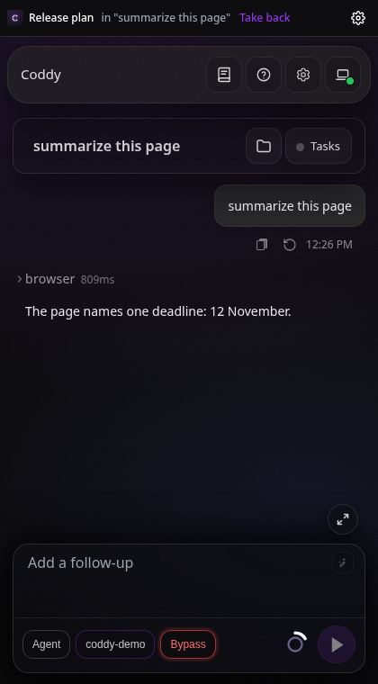
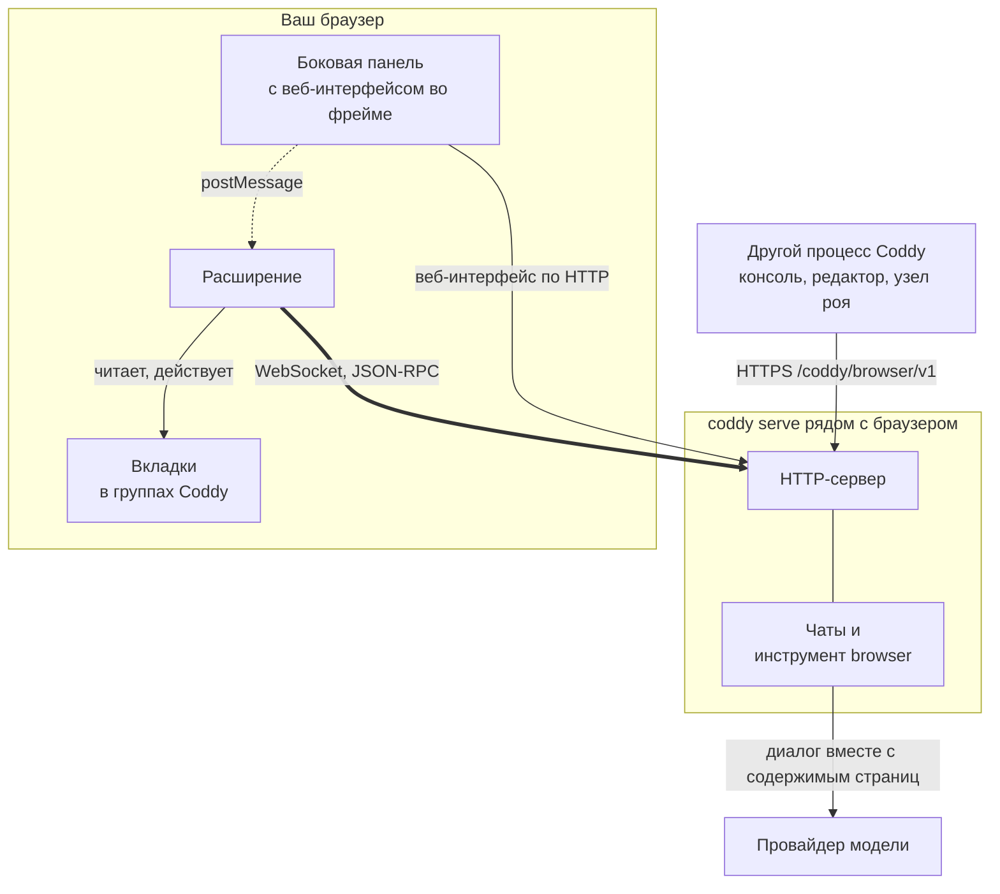
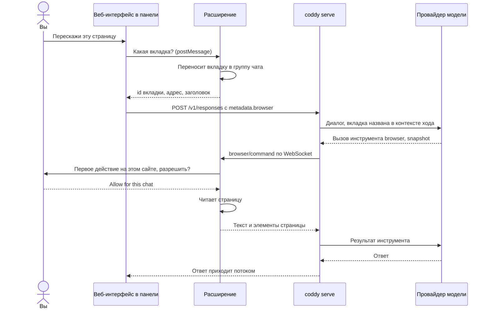
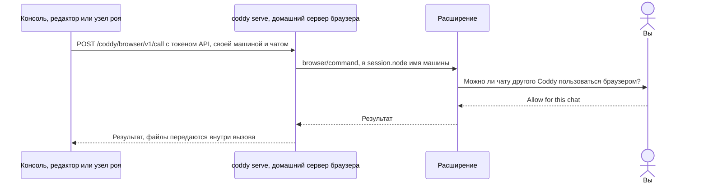
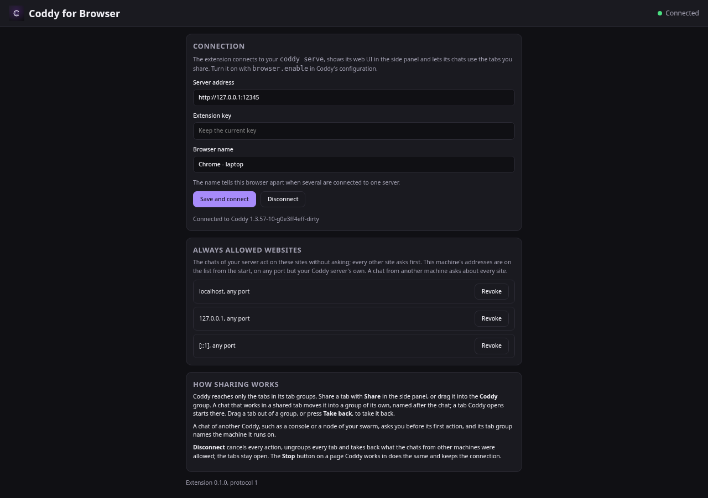
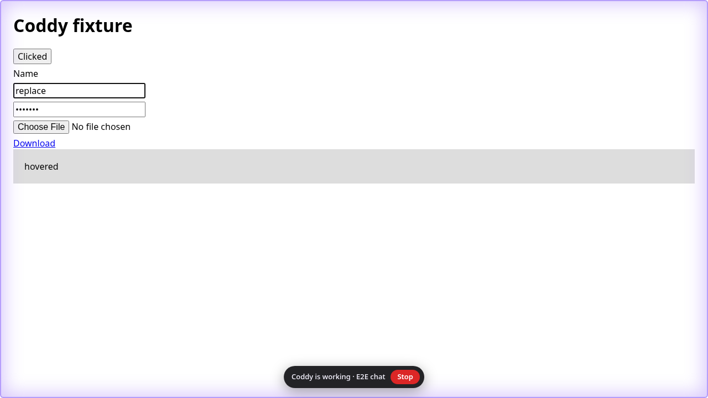
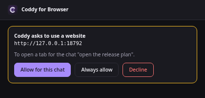
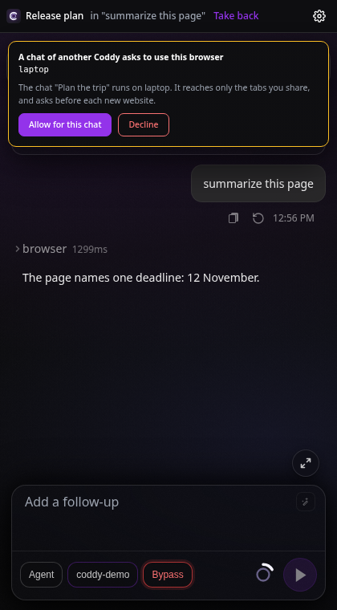

# Coddy for Browser

Расширение для Chrome, Яндекс Браузера и Firefox, через которое ваш собственный агент
[Coddy](https://github.com/coddy-project/coddy-agent) работает в браузере, которым вы пользуетесь каждый день. С Coddy
можно переписываться в боковой панели рядом со страницей, а можно дать браузер любому другому чату Coddy - в
веб-интерфейсе, консоли, редакторе, Telegram, задании планировщика или на другой машине вашего роя. Чат открывает
вкладку, читает страницу, кликает, печатает, делает скриншоты и переносит файлы, а расширение выполняет это во
вкладках, которые вы ему дали.

[English version](README.md)

<p align="center">
  
</p>

Расширение общается только с сервером Coddy, адрес которого вы указали. Модель работает на этом сервере, расширение
выполняет действия и спрашивает вас, прежде чем Coddy впервые возьмётся за новый сайт.

## Как это устроено

### Из чего состоит



- **Соединение открывает расширение.** Оно держит один WebSocket к HTTP-серверу `coddy serve`, своему домашнему
  серверу. Действия Coddy приходят по этому сокету запросами, на которые расширение отвечает, поэтому Coddy
  добирается до браузера, к которому у сервера нет маршрута, и ноутбук за NAT работает так же, как браузер на самом
  сервере;
- **боковая панель - это веб-интерфейс.** Кнопка расширения на панели открывает рядом со страницей веб-интерфейс того
  же сервера. Вход выполняется по одноразовому тикету, который расширение получает по своему сокету, и в панели есть
  всё поле ввода целиком, с моделями, вложениями, режимами разрешений и историей. Вкладка, из которой вы пишете,
  попадает в группу чата ещё до отправки сообщения, поэтому просьбы "перескажи эту страницу" или "заполни эту форму"
  работают со страницей перед вами;
- **браузером пользуется любой чат вашего Coddy.** Консоль или редактор на той же машине и другие узлы роя
  обращаются к браузеру через HTTP API домашнего сервера (`browser.serve_remote`). Перед первым действием такого чата
  расширение спрашивает вас и называет машину, на которой он работает;
- **что видит Coddy, решают группы вкладок.** Coddy видит только вкладки в своих группах браузера. Чтобы дать вкладку
  всем чатам, нажмите **Share** в боковой панели или перетащите вкладку в группу **Coddy**. Чат, который начал
  работать в общей вкладке, переносит её в собственную группу с названием чата, и другие чаты там действовать не
  могут. Вкладка, которую открыл Coddy, сразу попадает в группу чата. Чтобы забрать вкладку, вытащите её из группы
  или нажмите **Take back**;
- **сайты одобряете вы.** Перед первым действием на сайте небольшое окно расширения спрашивает, разрешить ли его для
  этого чата, разрешить всегда или отказать. "Всегда" действует только для чатов домашнего сервера, а чат с другой
  машины спрашивает про каждый новый сайт. Страница не может ответить на эти вопросы за вас. Страницы на вашей
  машине (`localhost`, `127.0.0.1`, `[::1]`, любой порт) с самого начала стоят в списке сайтов, разрешённых всегда,
  кроме самого сервера Coddy, в веб-интерфейсе которого одобряются запросы чатов. Убрать их из списка можно, как
  любой другой сайт;
- **остановить можно в любой момент.** Кнопка Stop на странице, где работает Coddy, отменяет все действия,
  распускает все группы и отзывает разрешения чатов с других машин, а вкладки остаются открытыми. **Disconnect** на
  странице настроек делает то же самое и закрывает подключение.

### Ход из боковой панели



### Чат другого процесса Coddy



### Что куда передаётся

| Что | Откуда | Куда | Как |
| --- | --- | --- | --- |
| Действия Coddy и их результаты | `coddy serve` | в расширение и обратно | WebSocket, который открыло расширение, JSON-RPC 2.0 |
| Ключ расширения | расширение | его домашний сервер | в `initialize`, один раз на подключение; хранится в хранилище расширения |
| Веб-интерфейс панели | домашний сервер | фрейм панели | обычный HTTP веб-интерфейса, вход по одноразовому тикету из сокета |
| Вкладка, из которой вы пишете | панель | веб-интерфейс, затем сервер | `postMessage` внутри браузера, затем `metadata.browser` в сообщении |
| Текст страницы, элементы и скриншоты | расширение | сервер, затем провайдер модели | результаты инструмента `browser` |
| Файлы | страница или рабочая папка | другая сторона | одноразовые тикеты под `/browser/v1/files/`, до 32 МиБ |
| Вызовы другого процесса Coddy | этот процесс | домашний сервер | HTTPS `/coddy/browser/v1` с API-токеном домашнего сервера |
| Ваши ответы про сайты и чаты | - | - | остаются в браузере и до Coddy не доходят |

Протокол описан в документации Coddy на странице [Протокол браузера](https://coddy.dev/docs/reference/browser-protocol).
Сторона Coddy и её настройка описаны на странице [Coddy for Browser](https://coddy.dev/docs/features/browser).

## Что нужно

- Браузер:
  - Chrome 116 или новее;
  - Яндекс Браузер или другой браузер на Chromium, с тем же пакетом, что и Chrome. Боковой панели в Яндекс Браузере
    нет, поэтому веб-интерфейс открывается в отдельном окне рядом с окном браузера;
  - Firefox 139 или новее, с пакетом для Firefox. API отладчика у расширений Firefox нет, поэтому Coddy кликает и
    печатает через страницу. Страница может отличить такой ввод от ввода человека, и сайт, который это проверяет
    (некоторые редакторы и формы входа), на него не отзывается;
- `coddy serve`, собранный с тегами `browser` и `ui`, с включённым HTTP-сервером. Они есть в бинарниках релиза, в
  Docker-образе и в пакетах;
- Coddy for Browser, включённый в `config.yaml` Coddy, с ключом не короче 32 символов.

  ```yaml
  browser:
    enable: true
    token: ${CODDY_BROWSER_KEY}
    serve_remote: true   # по желанию: браузером пользуются и чаты консоли, редактора или другого узла
  ```

  Ключ сгенерируйте командой `openssl rand -hex 32` и положите в `<home>/.env` как `CODDY_BROWSER_KEY`. Расширение
  подключается к HTTP-серверу, по тому же адресу, что и веб-интерфейс. Запускайте `coddy serve` на машине с
  браузером, а сервер на другой машине переведите на HTTPS. Простой HTTP расширение принимает только для
  `localhost`, `127.0.0.1` и `[::1]`. Машина, до которой можно добраться только через рой, входит в него через
  `swarm.join`, и другие узлы обращаются к её браузеру через релей.

## Установка

Пакеты прикреплены к каждому [релизу](https://github.com/coddy-project/coddy-for-browser/releases). Каждый прогон
[CI](https://github.com/coddy-project/coddy-for-browser/actions/workflows/ci.yaml) сохраняет сборку для каждого
семейства браузеров в артефактах `coddy-for-browser-chrome` и `coddy-for-browser-firefox`. Архив, который отдаёт
GitHub, - тот же пакет, что и в релизе, только без подписи (чтобы скачать артефакт, нужна учётная запись GitHub).

| Пакет | Браузеры |
| --- | --- |
| `coddy-for-browser-chrome-<version>.zip` | Chrome, Яндекс Браузер и другие браузеры на Chromium |
| `coddy-for-browser-firefox-<version>.xpi` | Firefox, с подписью Mozilla (в релизе, который был подписан) |
| `coddy-for-browser-firefox-<version>.zip` | Firefox, без подписи |

### Chrome

1. Распакуйте `coddy-for-browser-chrome-<version>.zip` в папку, которую не удалите.
2. Откройте `chrome://extensions`, включите **Режим разработчика** и нажмите **Загрузить распакованное расширение**,
   затем выберите эту папку.

### Яндекс Браузер

1. Распакуйте `coddy-for-browser-chrome-<version>.zip` в папку, которую не удалите.
2. Откройте `browser://extensions`, включите **Режим разработчика** и нажмите **Загрузить распакованное расширение**,
   затем выберите эту папку.

Кнопка расширения на панели открывает веб-интерфейс в отдельном окне у правого края окна браузера.

### Firefox

- **С подписью** (`.xpi`). Откройте файл в Firefox или перетащите его на страницу `about:addons` и подтвердите
  установку. Firefox хранит его как любое другое дополнение;
- **Без подписи** (`.zip`). Обычный Firefox ставит только дополнения, подписанные Mozilla. Откройте
  `about:debugging#/runtime/this-firefox`, нажмите **Загрузить временное дополнение** и выберите архив. Временное
  дополнение Firefox удаляет при закрытии. Firefox Developer Edition и Nightly оставляют архив без подписи
  установленным, если поставить его со страницы `about:addons` (**Установить дополнение из файла**) после того, как
  в `about:config` параметр `xpinstall.signatures.required` выставлен в `false`.

Кнопка расширения на панели открывает веб-интерфейс в боковой панели Firefox.

### Из исходников

Нужен Node.js 22 или новее, пакеты ставить не надо.

```bash
npm run build
```

`dist/chrome` - сборка для Chrome и Яндекс Браузера, `dist/firefox` - для Firefox. Загрузите их так же, как описано
выше.

## Подключение

Страница настроек открывается после установки, а позже по кнопке настроек в боковой панели (или из строки расширения
в списке расширений браузера). Введите адрес сервера (`http://127.0.0.1:12345` для локального сервера, тот же, что у
его веб-интерфейса), ключ и имя этого браузера, например `Chrome - laptop`, и нажмите **Save and connect**. Имя
различает браузеры, когда к одному серверу подключено несколько, и чат выбирает среди них.



В углу страницы настроек видно состояние подключения. Зелёная точка значит, что расширение подключено, жёлтая - что
оно подключается или повторяет попытку, серая - что подключение выключено, красная - что сервер отклонил ключ или
работает с другой версией протокола. **Disconnect** останавливает Coddy и закрывает подключение.

## Работа

Нажмите кнопку расширения и напишите в боковой панели, находясь на странице, с которой должен работать Coddy.

> Перескажи эту страницу и перечисли сроки, которые в ней упомянуты.

Панель - это веб-интерфейс. Ответ приходит по мере генерации, вызовы инструментов видны по мере выполнения, вопросы
Coddy появляются в чате, а сам чат - обычная сессия, которую можно продолжить где угодно. Полоска над ним показывает
вкладку, на которую вы смотрите, и в чьей группе она находится, кнопки **Share** и **Take back** и кнопку настроек, в
теме веб-интерфейса.

Если открыть панель на вкладке, в которой работает чат вашего сервера, панель покажет этот чат. Ход, начатый из
консоли, редактора или задания планировщика, идёт там потоком, как в любом чате, а имя чата в полоске снова
открывает его.

Из любого другого чата Coddy дайте вкладку или позвольте Coddy открыть её самому и попросите, например так.

> Открой список пул-реквестов coddy-project/coddy-agent и скажи, какие ждут ревью.

Чат вызывает инструмент `browser`. Он смотрит доступные вкладки, читает страницу как текст со ссылками на элементы,
кликает и печатает (в Chrome и Яндекс Браузере через отладчик, поэтому ввод доверенный, как у человека, а в Firefox
через страницу) и прикладывает скриншоты, если модель чата читает изображения. Пока Coddy работает во вкладке, она
подсвечена и показывает кнопку Stop, а название группы чата начинается с песочных часов.



Перед первым действием на сайте расширение спрашивает в собственном окне, а если боковая панель открыта, то в ней.

<p align="center">
  
</p>

Чат другого процесса Coddy сначала спрашивает разрешения и называет машину, на которой работает.

<p align="center">
  
</p>

## Разрешения

| Разрешение | Зачем |
| --- | --- |
| `tabs`, `tabGroups` | Читать вкладки в группах Coddy, открывать и группировать вкладки для чата. Группы вкладок есть в Firefox начиная с версии 139. |
| `scripting` | Читать страницу и находить элементы по ссылкам, показывать индикатор работы. |
| `debugger` | В Chrome и Яндекс Браузере - доверенные клики, ввод текста и клавиш, скриншоты через протокол DevTools. Пока отладчик подключён, браузер показывает полосу, а расширение отключается через 20 с после последнего действия. В Firefox такого API нет. |
| `storage` | Настройки подключения и сайты, которые вы разрешили. Ключ доступен только страницам самого расширения. |
| `alarms` | Будить service worker, чтобы переподключиться после того, как Chrome его остановил. В Firefox фоновая страница работает постоянно. |
| `notifications` | Сообщить, что Coddy просит доступ к сайту. |
| `sidePanel` | В Chrome - веб-интерфейс рядом со страницей. Firefox берёт боковую панель из манифеста, а Яндекс Браузер открывает окно. |
| `http://*/*`, `https://*/*` | Действовать на сайтах, которые вы разрешили, и достучаться до вашего сервера Coddy. Firefox вместо них просит `<all_urls>`, без которого не работает его скриншот вкладки (`tabs.captureTab`); действует расширение по-прежнему только на веб-страницах. |

Расширение ничего не отправляет никуда, кроме вашего сервера Coddy. Страницы, которые читает Coddy, всё равно
попадают к провайдеру модели, настроенному на вашем сервере.

## Разработка

```bash
npm test                      # модульные тесты, только Node
npm run build                 # dist/chrome, dist/firefox и их архивы
npm i --no-save playwright    # один раз, для прогона в Chromium
npx playwright install chromium
npm run e2e                   # сборка для Chrome в настоящем Chromium против имитации Coddy
npm i --no-save puppeteer-core
npm run e2e:firefox           # сборка для Firefox в настоящем Firefox против той же имитации
```

`CODDY_BROWSER_PATH` указывает прогону в Chromium на установленный браузер вместо Chromium из Playwright, например
Google Chrome или Яндекс Браузер. Такой браузер получает расширение через протокол DevTools, потому что брендовые
браузеры игнорируют `--load-extension`. `CODDY_FIREFOX_PATH` задаёт Firefox для прогона в Firefox,
`CODDY_SCREENSHOT_DIR` собирает скриншоты страниц расширения.

[CI](.github/workflows/ci.yaml) на каждый пуш и пул-реквест запускает модульные тесты, собирает оба пакета в
артефакты и прогоняет обе сквозные проверки. Тег `v<version>` публикует релиз с прикреплёнными пакетами. Если заданы
секреты `AMO_JWT_ISSUER` и `AMO_JWT_SECRET` (API-ключ addons.mozilla.org), сборка для Firefox ещё и подписывается как
дополнение вне каталога, и к релизу прикрепляется `.xpi` (`scripts/sign.mjs`).

| Файл | Что делает |
| --- | --- |
| `src/background.js` | Фоновая часть (service worker в Chrome, страница в Firefox) - связка модулей, сообщения боковой панели, окна одобрения и страницы настроек. |
| `src/platform.js` | Какие возможности есть у браузера (боковая панель, сайдбар, отладчик). |
| `src/panel.js`, `src/frame.js` | Боковая панель с веб-интерфейсом во фрейме, вход по тикету и мост, который даёт ходу его вкладку и забирает тему веб-интерфейса. |
| `src/connection.js` | WebSocket, `initialize`, keepalive и переподключения. |
| `src/rpc.js` | Сторона JSON-RPC 2.0. |
| `src/commands.js` | Каждое действие, о котором просит Coddy, с проверками перед ним. |
| `src/groups.js` | Группы вкладок Coddy и то, какой чат держит какую вкладку. |
| `src/approvals.js`, `src/policy.js` | Одобрение сайтов и проверка адресов. |
| `src/page.js`, `src/input.js`, `src/pageinput.js`, `src/indicator.js` | Что выполняется на странице, ввод через протокол DevTools (Chrome) или через страницу (Firefox), индикатор работы. |
| `scripts/build.mjs`, `scripts/sign.mjs` | Сборка для каждого семейства браузеров (манифест Firefox - Manifest V2) и подпись сборки для Firefox. |

Изменение протокола вносится в оба репозитория, в расширение и в `external/browser` в coddy-agent, вместе со страницей
протокола в том же изменении.

## Лицензия

MIT, см. [LICENSE](LICENSE).
